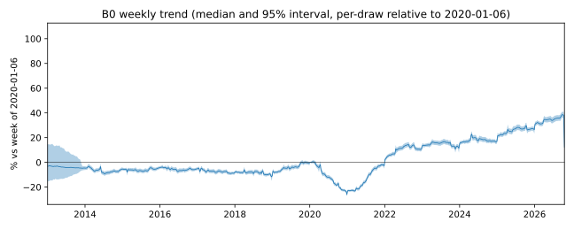
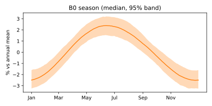

# B0 baseline fit, 2026-10-18

B0 is the design proposal's baseline: log net-effective latest ask on bedrooms, baths, a weekly
damped local linear trend, two seasonal harmonics and five ad flags, with Student-t errors scaled
by bedroom group. It has no location, size or building term. The model and sampler are in
`frontier/src/rentfrontier/b0.py`, the data step in `frontier/src/rentfrontier/b0data.py` (#1143).

## Run

- Run `b0-b0-latest-2a035de2-base` at master `2a035de2`, on a Modal L4, launched 18:41 ET.
  - 4 chains, 1,000 warmup and 1,500 draws per chain, every 10th draw kept (600 kept draws).
  - Wall time 45 min: 19 min sampling, 25 min PSIS-LOO and held-out scoring. Estimated cost $0.81.
- Data: every row of pipeline build `rows-1ed2cd98fe208d45` (built 2026-10-18 21:58Z at
  `e2ece10c`), 1,896,504 ads from 2010-07 to 2026-10-17, written to
  `/data1/apartments/frontier/datasets/b0-1ed2cd98fe208d45`.
  - The target is each ad's net-effective latest ask. I date it by the ad's last kept price
    change on or after the row's day (1,760,409 rows). When the ad has none, I fall back to the
    row's own day (134,633), the record's last collection (904), and a few smaller cases. Days
    are in UTC, as the pipeline takes them.
  - Latest split: the newest 189,650 ads are held out, and 1,706,854 train the model.
- Dropped indicators: the pipeline already excludes furnished and short-term ads, and every
  row of this build carries a bath count. So the furnished, short-term and unknown-bath columns
  are all zero, and `b0.design` leaves them out. Shared space (30,209 ads), income restriction
  (1,703) and rent stabilization (30,179) remain.
- Prior change from the brief: I set the trend's PC prior scale to U = 0.0003 a week instead of
  0.001. With 0.001 the prior predictive put 76% of rents between $1k and $30k; with 0.0003 it
  puts 90.5% there.

## Convergence

The fit fails the convergence gate on the trend's damping horizon h (R-hat 1.053, bulk ESS 69)
and on the slope shock scale τ (R-hat 1.021, ESS 158). Every coefficient, σ, ν, g and ν_T has
R-hat at or below 1.01 and ESS above 640. I have not refit. The likely cause is structural:
the weekly ad mix moves the weekly mean about 0.018 in log rent from week to week, against 0.011
expected from noise alone, and the trend absorbs it by collapsing h toward its lower edge. A
model without location has nowhere else to put that composition change.

## Scores

| Measure | Value |
|---|---|
| PSIS-LOO elpd (1,706,854 rows) | -357,525 (SE 1,008; building-clustered SE 9,975) |
| p_loo | 346 |
| Pareto k | max 0.67; 1 row over the 0.64 threshold for 600 draws, none over 0.7 |
| Held-out 80% coverage (nominal 0.79) | 0.801 |
| Held-out 95% coverage (nominal 0.95) | 0.957 |
| Held-out median absolute error | 20.3% |
| Held-out bias | +1.1% |
| Held-out elpd (189,650 rows) | -38,782 |
| Descriptive share | 0 (no location or building terms) |

The paired comparisons against the NB9 board are not possible here. B0 trains on the new
pipeline's rows and targets the net-effective ask, so it shares no row set with the earlier fits.

## Coefficients

Premiums are 100·(e^β − 1), with posterior median and 95% interval. Bedroom and bath terms are
cumulative steps: each is the premium for one more bedroom or bath past the one before.

| Term | Median | 95% interval |
|---|---|---|
| Base rent α (studio, 1 bath, at the trend's 2010-07-26 origin) | $3,157 | $2,231 to $5,286 |
| 1st bedroom | +21.1% | +20.9 to +21.2 |
| 2nd bedroom | +2.7% | +2.6 to +2.8 |
| 3rd bedroom | +2.4% | +2.2 to +2.6 |
| 4th bedroom | -1.0% | -1.3 to -0.6 |
| 5th bedroom | +4.5% | +3.7 to +5.3 |
| 2nd full bath | +62.3% | +62.1 to +62.5 |
| 3rd full bath | +65.9% | +65.1 to +66.7 |
| 4th full bath | +40.4% | +38.7 to +42.1 |
| Half bath | +32.0% | +31.7 to +32.3 |
| Shared space | -12.1% | -12.5 to -11.8 |
| Income restricted | -15.2% | -16.5 to -14.1 |
| Rent stabilized | -13.7% | -13.9 to -13.3 |

The interval on α is wide only because α and the trend's level trade off against each other.
The tables below fix the trend at a given week, so their intervals are narrow.

I checked the bedroom and bath coding before the fit. Median rent rises with bedrooms in the raw
data, from $2,594 for a studio to $5,800 for five bedrooms. Among 1-bath ads, though, 2-bedroom
ads ask less than 1-bedroom ads ($3,100 vs $3,157), while 2-bedroom, 2-bath ads ask $5,750. In
this market extra bathrooms go with expensive buildings and neighborhoods, and a second bedroom
on one bath often goes with cheaper ones. With no location term, the baths absorb most of the
location premium, and the bedroom steps past the first come out near zero. Later models with
location and size should move that premium back off the bath steps.

## Hyperparameters

| Quantity | Median | 95% interval |
|---|---|---|
| Residual ν | 22.2 | 21.7 to 22.8 |
| σ, studio | 0.237 | 0.236 to 0.237 |
| σ, 1 bedroom | 0.283 | 0.282 to 0.283 |
| σ, 2 bedrooms | 0.285 | 0.285 to 0.286 |
| σ, 3+ bedrooms | 0.347 | 0.346 to 0.348 |
| Trend growth g | +2.4%/yr | -0.4 to +5.1 |
| Damping horizon h | 0.08 months (2.3 days) | 0.06 to 0.11 months |
| Slope shock scale τ | 0.0023/week | 0.0018 to 0.0031 |
| Slope shock tails ν_T | 1.10 | 1.01 to 1.35 |
| Half bath over 2nd full bath (log scale) | 0.57 | 0.57 to 0.58 |

## Trend and season

Relative to the week of 2020-01-06, I take each draw's trend and report the median and 95%
interval:

| Week | Trend |
|---|---|
| 2016-06-06 | -5.5% (-7.1 to -3.8) |
| 2019-06-03 | -3.7% (-5.4 to -1.9) |
| 2020-12-28 (trough) | -26.1% (-27.4 to -24.8) |
| 2021-06-07 | -16.5% (-17.9 to -14.9) |
| 2022-08-01 | +13.8% (+12.0 to +15.8) |
| 2024-06-03 | +19.9% (+17.8 to +22.2) |
| 2026-10-05 | +38.4% (+36.1 to +40.9) |

The season peaks in mid-June (day 165), and peak to trough spans 5.1% (3.5 to 6.6).

## Predictive medians and intervals

For an ad posted in the week of 2026-10-12 with no flags, the model predicts:

| Ad | Median | 80% interval | 95% interval |
|---|---|---|---|
| Studio, 1 bath | $3,540 | $2,580 to $4,840 | $2,160 to $5,780 |
| 1 bedroom, 1 bath | $4,280 | $2,950 to $6,230 | $2,390 to $7,700 |
| 2 bedrooms, 1 bath | $4,400 | $3,020 to $6,420 | $2,440 to $7,980 |
| 2 bedrooms, 2 baths | $7,140 | $4,900 to $10,380 | $3,960 to $12,860 |
| 3 bedrooms, 2 baths | $7,310 | $4,620 to $11,530 | $3,550 to $14,930 |

On the held-out rows the median 80% interval spans a factor of 2.1 from bottom to top, and the
95% interval a factor of 3.2. The width comes from leaving out location.

## Prediction scorecard

I wrote these predictions before the fit. Prediction 1 cannot be tested with this fit.

| # | Prediction | Result | Hit |
|---|---|---|---|
| 2 | 2nd bedroom step δ_2 is +25% to +45% | +2.7% | miss |
| 3 | 2nd full bath φ_2 is +8% to +20% | +62.3% | miss |
| 4 | Half bath is 0.3 to 0.6 of φ_2 | 0.57 | hit |
| 5 | Season peaks June to August, peak to trough 2% to 6% | mid-June, 5.1% | hit |
| 6 | The 2020 trough is at least 10% below early 2020 | -26.1% at 2020-12-28 | hit |
| 7 | g is +2% to +4% a year, h is 6 to 24 months, ν_T < 4 | g +2.4%, h 0.08 months, ν_T 1.10 | miss (h) |
| 8 | At most 2 of the 10 largest slope shocks fall outside Mar 2020 to Dec 2022, and those coincide with a scrape coverage change | 4 outside | miss |
| 9 | Residual ν < 3 | 22.2 | miss |

Predictions 2 and 3 miss because the baths stand in for location (see Coefficients). Prediction
7 misses on h for the composition reason given under Convergence; g and ν_T fall inside their
ranges. Prediction 9 misses by a wide margin. Without location the residuals are wide (σ near
0.28), and the tails come out close to normal at that width.

The four large shocks outside the COVID window:

- 2026-10-12 (87.6 τ, the largest of all) is the last week of data. It holds 4,225 ads at a
  median $4,350, against about 3,100 a week at $4,500 to $4,650 in the weeks before. All 904
  ads whose ask comes from the page price, dated by the record's last collection, fall in that
  week, at a median $3,250. The rest of the week asks a median $4,763, in line with the week
  before. That is a change in how the data step dates asks at the data's edge, which counts as
  a coverage change.
- 2014-06-02 (20.9 τ) sits where the weekly median drops from $3,250 to $3,000 at constant
  volume. I see no change in coverage.
- 2018-12-31 (16.5 τ) and 2024-12-30 (15.9 τ) follow holiday weeks with about half the usual
  volume. The holiday dip is a seasonal volume change, not a change in scrape coverage.

So three of the four lack a coverage change, and the prediction misses on both counts.

## Next

- The h and τ failures and the misses on predictions 2, 3, 7 and 9 all point to the missing
  location term. Location and size terms come next in the design proposal.
- The last week's shock comes from the 904 page-price asks, which the data step dates by the
  record's last collection. A later data step could date them by the change behind the page
  price, or leave them out of the trend's last week.
