# Model Lineage, Structure & Research Artifact Map

This document is the structural map of the NYC asking-rent modeling project as of **2026-11-22**.
It records how the model evolved across four generations, the tree of branches and outcomes,
the hierarchical graphical structure (self-contained, plain-English plate diagrams for the active
Drift family and every model permutation that changes the probabilistic structure), what currently
serves each section of the site, and the methodology governing future iterations.

For the full chronological experiment ledger, see [docs/research-record.md](../research-record.md).
For detailed sampler derivations and run commands, see [docs/model/drift.md](drift.md).
For the module-by-module code map, see [frontier/README.md](../../frontier/README.md).

---

## How to Read the Plate Diagrams & Plain-English Glossary

Every plate diagram below reads **top to bottom**, showing how the model combines citywide trends,
neighborhood geography, building memory, apartment memory, and listing-level features to predict
each apartment listing's log asking rent ($y_i$):

- **Boxes ("plates")** mean a parameter is repeated for every item listed in the box corner — for
  example, one value per week ($w$), borough zone ($z$), building ($b$), quarter ($q$), apartment
  ($u$), bedroom group ($g$), or observed listing ($i$). Nested plates live inside their parent
  (apartments $u$ inside buildings $b$).
- **Node shapes & colors**: **blue shaded circles** are observed data ($x_i$ listing features and
  $y_i$ observed asking rent); **plain white circles** are learned latent parameters; **double
  circles** ($\mu_i$) are a deterministic sum of all incoming arrows; **dashed crimson** nodes,
  plates, and arrows highlight what is **new or upgraded** relative to the parent model.
- **Equation bar**: the shaded box at the bottom of every diagram writes out the exact additive
  prediction equation for listing $i$ together with its noise distribution and what changed.

### Plain-English Glossary of Abbreviations, Symbols & Jargon

| Term / Symbol | Plain-English Meaning |
|---|---|
| **$y_i$, $\mu_i$, $\mathbf{x}_i$, $\boldsymbol{\beta}$** | **$y_i$** is the observed log asking rent for listing $i$ (gross ask in Gen 1–2; net-effective ask after coded free months in Gen 3–4). **$\mu_i$** is the model's expected log rent (deterministic sum of all mean components). **$\mathbf{x}_i$** is listing $i$'s vector of observed features (beds, baths, sqft, floor, amenities, layout cues), weighted by learned **$\boldsymbol{\beta}$** feature effects. |
| **$L(w)$ / $g_t$ / $g_q$** | **Citywide market trend** over time: a smooth random walk (**RW**) across months ($g_t$), quarters ($g_q$), or ~676 weeks ($L(w)$) plus seasonal harmonics so the model tracks NYC-wide rent booms, dips, and summer/winter cycles. In B0 (Gen 3a), $L(w)$ uses a **LLT** (damped local linear trend with heavy-tailed slope shocks). |
| **HSGP / $F_z(s)$** | **Spatial neighborhood map** ("Hilbert-Space Gaussian Process"): a fast math approximation to a smooth 2D rent heat-map (~1 km resolution) fit separately for Manhattan and the Outer boroughs ($z \in \{\text{Manh.}, \text{Outer}\}$), so nearby buildings share location value. |
| **GP (`RBF/SE` vs `Matérn-3/2`)** | **Gaussian Process** (smooth curve prior) used for floor-height curves and quarterly market-segment paths $h_s(q)$. Older prototypes used **RBF / SE** (infinitely smooth), which struggled with sharp COVID-19 bends and got stuck in competing modes. **Matérn-3/2** allows realistic bends and sharp turns cleanly. |
| **$\eta_b$, $b_j$, $\gamma_b$, $\ell_m$** | **Building-level terms**: permanent building offset around the neighborhood map (**$\eta_b$** in Gen 3–4; **$b_j$** with a `ZeroSumNormal` constraint in Gen 1–2). Gen 1c–2e also tested per-building feature slopes (**$\gamma_b$**, e.g. different price per bedroom/sqft in each building). **LN1** (`$\ell_m$`) nests a building × (bed, full-bath) "line" baseline inside each building. |
| **AR(1) / OU / $a_b(q)$, $w_b(h)$, $d_u(t)$** | **Slowly fading drift over time**: **AR(1)** (quarterly autoregressive path $a_b(q)$, carrying $\rho \approx 0.89$ per year) lets an entire building run temporarily hot or cold (landlord-wide repricing cycles; Gen 1–2 used a simpler half-year/quarterly walk $w_b$). **OU** (Ornstein-Uhlenbeck process $d_u(t)$) is the continuous-time version for an individual apartment, fading back toward its permanent baseline over $\tau_u \approx 2.8$ years (replacing Gen 1c/2d's non-fading linear slope $\delta_u t_i$). |
| **$s_u$ / $u_u$** | **Permanent apartment baseline**: each apartment's lasting offset above or below its building (capturing unmeasured views, layout quality, light, or renovation tier). Upgraded from Gaussian to heavy-tailed Student-t ($\nu_u = 3$ in `unitkn`) so genuinely unusual units aren't over-shrunk toward their building median. |
| **Student-t ($\nu, \kappa_u, \lambda_i$)** | **Heavy-tailed outlier protection**: normal bell curves panic when one listing is wildly mispriced. Giving buildings ($\nu_b = 4$), apartments ($\nu_u = 3$, scale-mixed by $\kappa_u$), and individual listings ($\nu = 2$, scale-mixed by outlier weight $\lambda_i$) Student-t tails lets the model downweight wild asks instead of skewing neighbors. |
| **$\sigma_g$, $\phi_p$, $\phi_f$, $\psi_{\text{yr}}$, $k_m$** | **Heteroskedastic listing noise**: instead of one flat error bar ($\sigma$), base noise **$\sigma_g$** varies by bedroom group ($g \in \{0, 1, 2, 3+\}$), then multiplies by **lease phase $\phi_p$** (months since prior ad: quick 0–9m re-lists are noisier than 10–13m renewals), **calendar year $\psi_{\text{yr}}$** (**Y1**: 2020–21 were ~1.65× noisier than 2024), and **binary flags $k_m$** (**D1** duplex, **I1** income-restricted, or the 6 exogenous flags in **Gen 4k** $\phi_f$, where 3+ baths is 3.25× noisier). |
| **`as-of` / `umean:` / `bedtext` / `layout-range`** | **Leak-free listing features in $\mathbf{x}_i$**: **as-of** features use only information known before listing $i$ went live (zero future rent leakage). **`umean:`** summarizes an apartment's prior non-rent attributes. **`bedtext` / `bedunit`** flags ads whose description mentions fewer rooms than the structured bed count (e.g. "flex 2BR"). **`layout-range`** flags when an ad's listed beds/baths disagree with prior ads for the same unit. **`same_bed_first`** fills missing sqft from same-bedroom unit history first. |
| **`unitkn` / `l2bt` / `range-j`** | **Model shorthand names**: **`unitkn`** = collapsed Student-t(3) unit baseline + fixed $\nu = 2$ listing tails. **`l2bt`** = prior best `latest`-split model (`L2` lease-phase means + `bedtext`). **`range-j`** = active served `/deals` model (`drift-building` with `bedtext` + `layout-range` and 13 fixed scales on the `market` backtest). |
| **ELPD / R-hat / ESS** | **How we grade & trust a fit**: **ELPD** (expected log predictive density, in nats) measures out-of-sample log-probability on held-out ads — higher means sharper, better-calibrated predictions. **Split R-hat $\le 1.01$** proves independent MCMC chains converged to the same posterior; **bulk ESS $> 400$** proves enough independent posterior draws. |

---

## 1. Four-Generation Evolution Tree

Every score on the **latest split** is measured on the same **189,647 held-out ads** (a 10%
unit draw holding out the newest ad of apartments with at least two ads; higher elpd is better,
units are nats). Backtest scores are on the **9,346 open ads as of 2025-11-10** (final asks
for elpd/MAE/coverage; first asks net of coded free months for days-on-market and cut rates).
The convergence gate requires **split R-hat <= 1.01** and **bulk ESS > 400** on every scalar
and coefficient.

Every step below uses plain relative Markdown links to its experiment note and code module
so the tree works natively in any editor, viewer, or git host. Every permutation that
**changes the probabilistic / graphical model structure** embeds its self-contained plate
diagram inline immediately below the entry (**dashed crimson** nodes, plates, and edges
highlight what changed relative to the parent; column-only, data-only, and sampler-only
variants share their parent's plate diagram).

### Generation 1 — Chelsea PyMC / NUTS Line (Aug – Sep 24, 2026)
*52k unit-months, Chelsea only; full narrative in [main-model-evolution.md](main-model-evolution.md).*

- **Sierra monthly & weekly indexes** (Aug 2026) — initial single-building and three-building Bayesian random-walk indexes ([history](main-model-evolution.md)).
  - **All-Chelsea pooled Bayesian** (Sep 8) — 2,386 obs, gate pass, 6.51% holdout MAE vs 11.61% naive ([history](main-model-evolution.md)).

    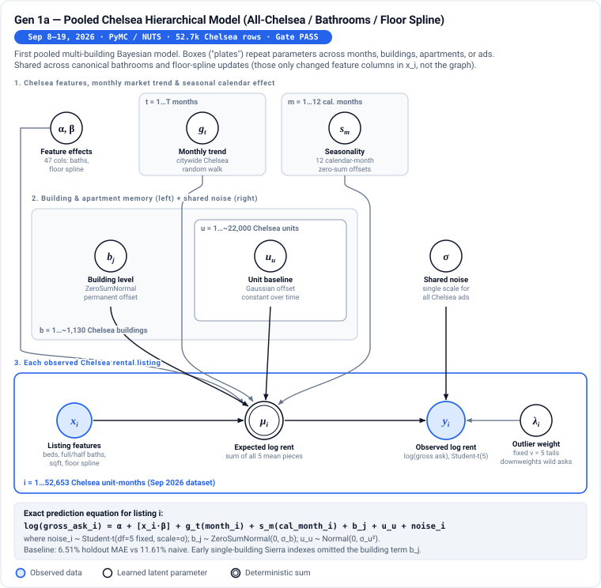

    *Reading the structure:* Every Chelsea listing's expected log rent ($\mu_i$) adds five pieces — listing attributes ($\mathbf{x}_i^\top \boldsymbol{\beta}$), a shared monthly random walk ($g_t$), 12 calendar-month seasonal offsets ($s_m$), a permanent building offset ($b_j$), and a permanent apartment offset ($u_u$) — with a single Student-t($\nu=5$) error width ($\sigma$) downweighting extreme asks via $\lambda_i$.

    - **Canonical-unit robust & Bayesian bathrooms** (Sep 17–18) — 52,711 rows, explicit full/half baths, gate pass; same graphical structure as Gen 1a ([history](main-model-evolution.md)).
      - **Floor natural cubic spline + expanded proxies** (Sep 19) — replaced 51 increments (6.96M -> 1.51M leapfrog transitions), gate pass; same graphical structure as Gen 1a ([spline](floor-spline-experiment-2026-09-19.md), [expanded](expanded-floor-source-experiment-2026-09-19.md)).
        - **Bedroom-group time curves + building half-year drift walk** (Sep 22–23) — +825.5 row / +379.5 unit elpd, gate pass ([bedroom time](bedroom-time-experiment-2026-09-22.md), [building drift](building-drift-experiment-2026-09-23.md)).

          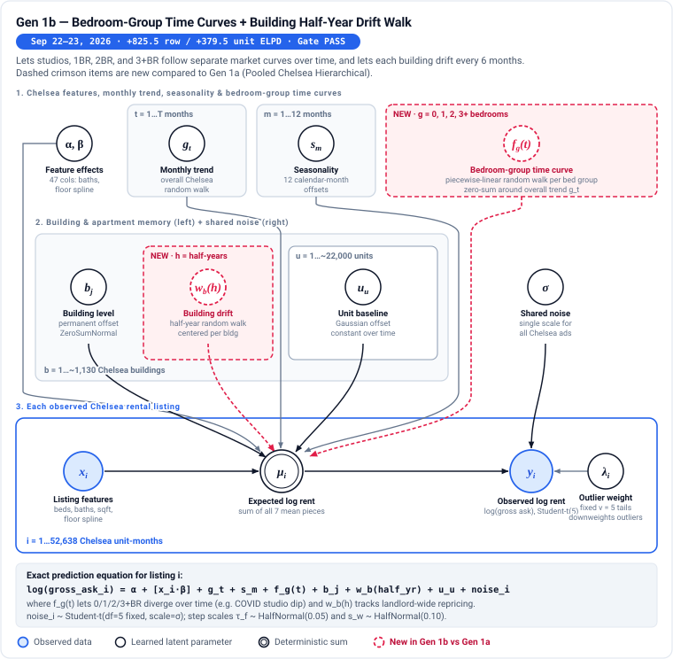

          *What changed & why:* Adding $f_g(t)$ lets studios, 1BRs, 2BRs, and 3+BRs follow distinct market trajectories (for example, studios dipping harder during COVID-19 than large apartments), while adding $w_b(h)$ inside the Building plate allows each building to drift every six months as landlords reprice or renovate.

          - **Combined v2 bridge** (Sep 24) — per-building slopes + as-of flags + unit drift + free $\nu$; final PyMC/NUTS model ([note](combined-v2-bridge-2026-09-24.md)).

            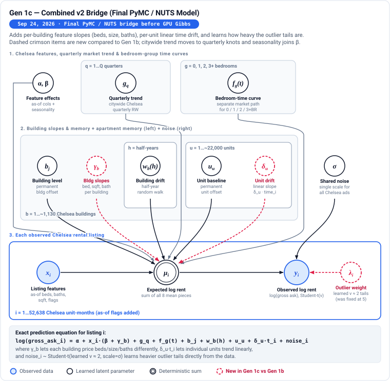

            *What changed & why:* Adds per-building feature slopes ($\gamma_b$, so each building can price extra bedrooms, square footage, and baths differently), a per-apartment linear drift ($\delta_u t_i$), and frees the outlier tail parameter $\nu$ (which settles near $\nu \approx 2$, much heavier-tailed than the old fixed $\nu=5$).

### Generation 2 — Frontier GPU Gibbs Line (Sep 24 – Oct 17, 2026)
*Chelsea -> NB5 -> NB8 -> NB9 -> All-Scraped Manhattan & Brooklyn; see [leaderboard](leaderboard/leaderboard.md) and [feature-tests.md](feature-tests.md).*

- **`m0-base` -> `m1-walk` -> `m5-nocurves`** (Sep 24–29) — custom JAX GPU Gibbs sampler, +9,747 LOO, served Sep 29 ([leaderboard](leaderboard/leaderboard.md)).

  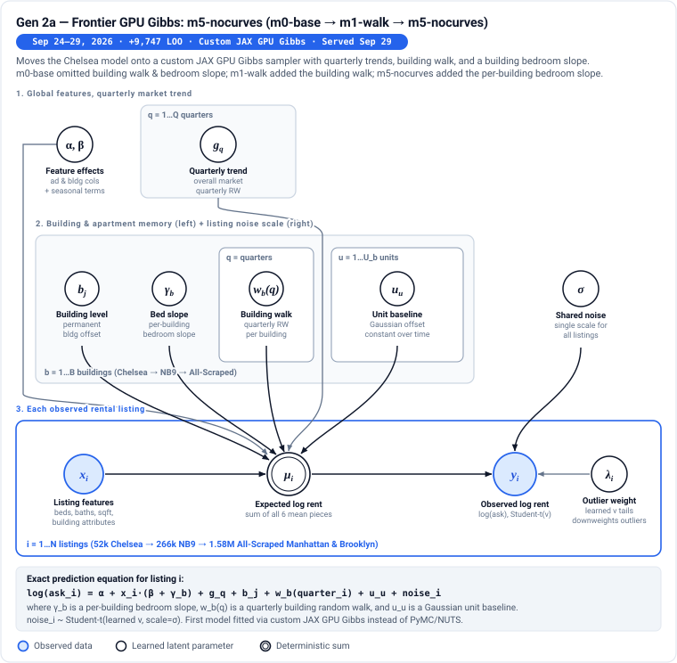

  *Reading the structure:* Ported the Chelsea hierarchy onto a custom JAX GPU Gibbs sampler so fits could scale beyond PyMC/NUTS. Uses a quarterly market trend ($g_q$), quarterly building walk ($w_b(q)$), a single per-building bedroom slope ($\gamma_b$), Gaussian unit baselines ($u_u$), and learned Student-t listing noise.

  - `m6-slopes` — bedroom-time curves + per-building size/bath slopes; **failed** all-effects gate on bimodal 110 W 26th ([leaderboard](leaderboard/leaderboard.md)).

    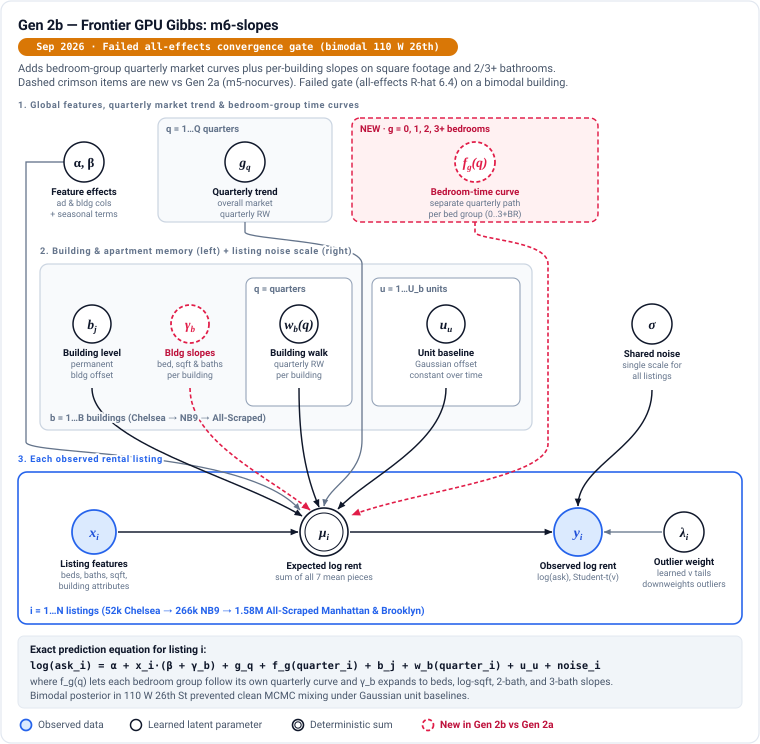

    *What changed & why it missed:* Brought back quarterly bedroom-group curves ($f_g(q)$) and expanded $\gamma_b$ to per-building square-footage and 2/3-bath slopes. Under thin-tailed Gaussian unit baselines ($u_u$), an unusual building (110 W 26th St) created a bimodal posterior and tripped the convergence gate (`R-hat = 6.4`).

  - **`m7-tunits`** (Student-t unit levels, +12,891 LOO) ([leaderboard](leaderboard/leaderboard.md)):

    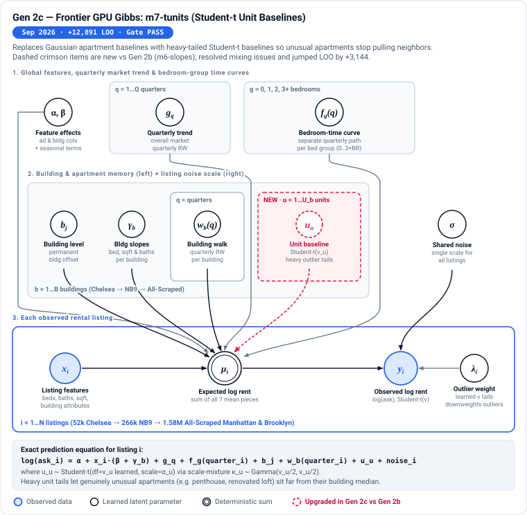

    *What changed & why:* Switched apartment baselines $u_u$ from Gaussian to heavy-tailed Student-t($\nu_u$) so unusual units (penthouses, renovated lofts, misclassified layouts) stopped pulling building slopes and neighboring units, resolving the mixing failure and gaining +3,144 LOO.

    - **`m8-drift`** (per-unit linear drift, +13,230 LOO) ([leaderboard](leaderboard/leaderboard.md)):

      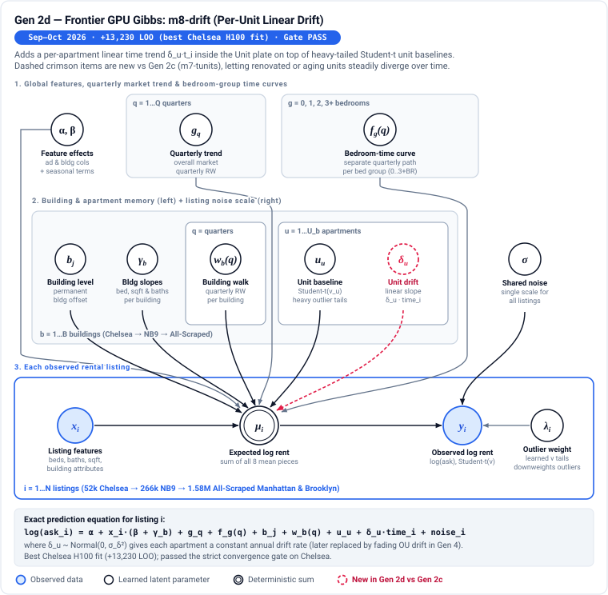

      *What changed & why:* Added a per-unit linear time slope ($\delta_u \cdot t_i$) inside the Unit plate on top of heavy-tailed unit baselines — the strongest Chelsea H100 fit — though linear drift extrapolates aggressively over long gaps (later replaced by fading OU drift in Gen 4).

  - **Multi-neighborhood Design C** (`bednoise` + `dayfourier` + `bedtime` + `yearnoise` + `sizeunkslope`, fixed $\nu_u=4$) — served on NB5 (Oct 8), NB8 (Oct 10), and all-scraped Manhattan+Brooklyn (Oct 17); **gate miss** on all-scraped (`max R-hat 1.093`, `ESS 11.7`), still backs legacy `site/current/site.sqlite` ([mixing review](mixing-review-2026-10-17.md)).

    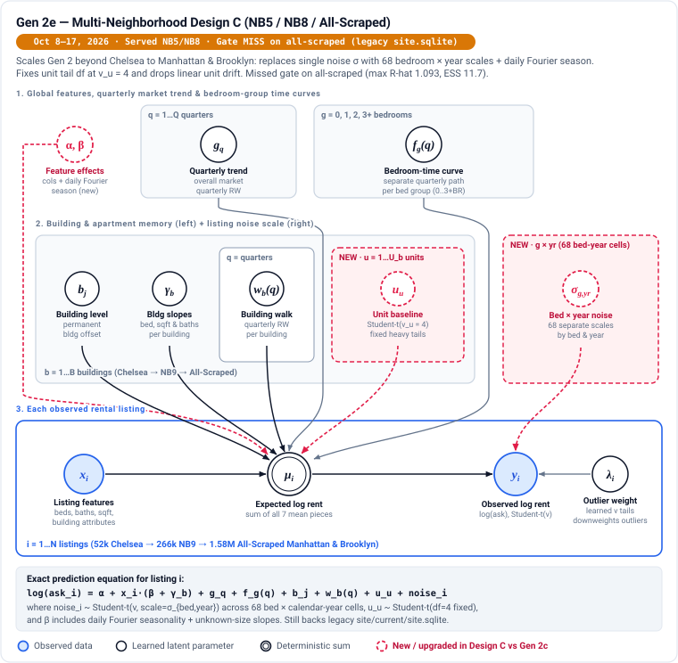

    *What changed & why:* Scaled Gen 2 to 1.58M Manhattan & Brooklyn listings by adding daily Fourier seasonality to $\boldsymbol{\beta}$, replacing single noise $\sigma$ with 68 separate bedroom × calendar-year scales ($\sigma_{g,\text{yr}}$), and fixing unit tail df at $\nu_u = 4$ (dropping linear drift). Passed on 9 neighborhoods (NB9) but missed the convergence gate on all-scraped data, motivating the clean Gen 3 rebuild.

  - *Methodological foundations adopted here:* [leak-free latest split](../leak-free-scoring.md) (Oct 7), clustered SEs and [new-building score](newbuilding-2026-10-13.md) (Oct 13).

### Generation 3 — B0 / Building-Zones Line (Oct 18 – Oct 24, 2026)
*Fresh start on 1.90M NYC-wide ads; none served, but became the exact column, map, and walk backbone of Generation 4.*

- **[`b0` baseline](b0-baseline-2026-10-18.md)** — damped local linear weekly trend + bedroom-group Student-t noise; no spatial, building, or unit plates:

  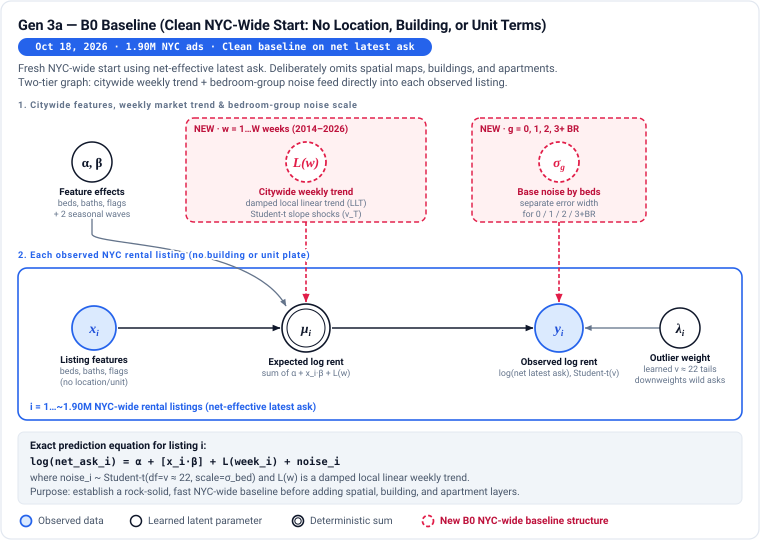

  *Reading the structure:* A deliberately simple two-tier NYC-wide baseline on net-effective latest ask: basic bed/bath/flag features ($\alpha + \mathbf{x}_i^\top\boldsymbol{\beta}$), a damped local linear weekly market trend ($L(w)$), and four bedroom-group noise widths ($\sigma_g$) with heavy Student-t tails — zero geography, building, or apartment memory yet.

  - Normal walk -> two-zone whitened 1 km HSGP -> **[`building_zones_gibbs`](../notes/building-zones-gibbs-2026-10-20.md)** -> **[as-of floor curves](../notes/building-zones-floor-asof-2026-10-23.md)** -> **Fit 8 (`asof3_cap64`)** — `elpd 148,234` | `MAE 6.9%` | `80% cov 79.8%` | **PASS** ([note](../notes/building-zones-floor-asof3-cap64-2026-10-23.md), [code](../../frontier/src/rentfrontier/building_zones_floor_asof3_cap64.py)).

    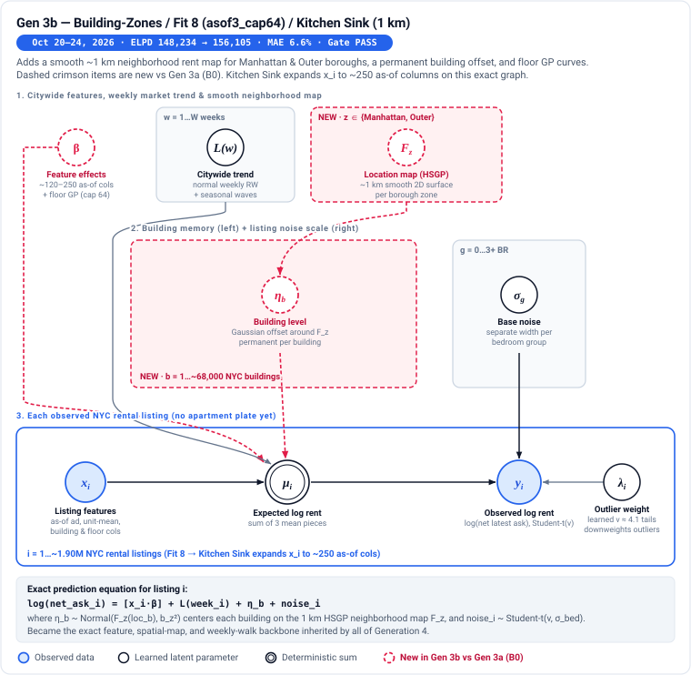

    *What changed & why:* Introduced the core Gen 3–4 backbone: a smooth ~1 km 2D neighborhood rent map ($F_z$) for Manhattan and Outer boroughs, a permanent building offset ($\eta_b$) centered on that map, smooth floor-height GP curves inside $\boldsymbol{\beta}$, and a normal weekly random walk ($L(w)$).

    - **Kitchen Sink (1 km, ~250 as-of cols)** — `elpd 156,105` (+7,871) | `MAE 6.6%` | `80% cov 80.1%` | **PASS**; expands $\mathbf{x}_i$ with the same Gen 3b graphical structure ([note](../notes/kitchen-sink-2026-10-23.md), [code](../../frontier/src/rentfrontier/building_zones_kitchen_sink.py)).
      - Kitchen Sink 150 m — OOM on 39.5 GiB GPU ([code](../../frontier/src/rentfrontier/building_zones_kitchen_sink_150m.py)).
    - **Fit 4 (`unitmean`)** — constant Gaussian unit effect: `elpd 177,137` (+28,903) | `MAE 5.8%` | `80% cov 78.9%` | **MISS** (68/121 beta pinned by unit effects) ([note](../notes/building-zones-floor-asof3-unitmean-2026-10-23.md), [code](../../frontier/src/rentfrontier/building_zones_floor_asof3_unitmean.py)).

      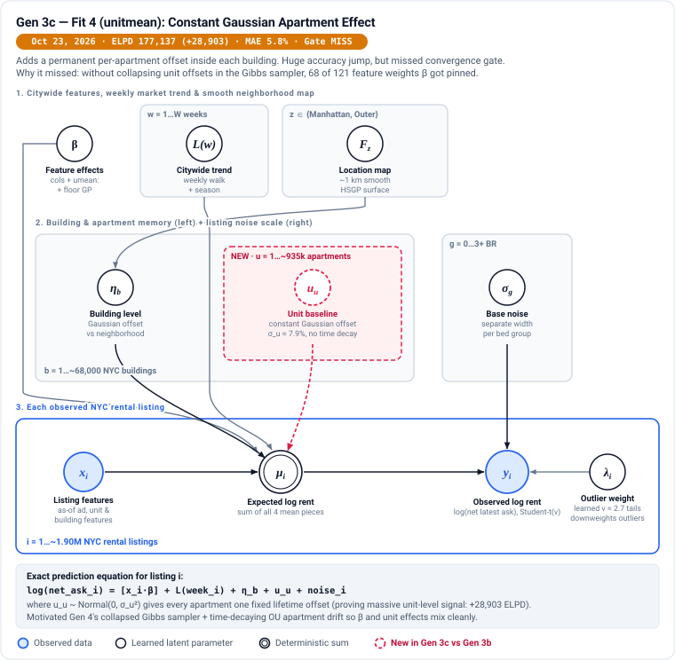

      *What changed & why it missed:* Adding one permanent Gaussian offset per apartment ($u_u$) inside the Building plate proved huge unit-level predictability (+28,903 ELPD), but sampling $\boldsymbol{\beta}$ conditionally on $u_u$ pinned 68 of 121 feature weights — directly motivating Gen 4's collapsed Gibbs sampler.

### Generation 4 — Drift Line (Nov 10 – Nov 22, 2026)
*Aim reset on 2026-11-10: descriptive asking-rent pricing with honest uncertainty for finding good deals.*

- **`drift`** (`f6` / `m6` / `k6`, Nov 10) — lasting unit level + OU unit drift: `elpd 195,320` (+39,215) | `MAE 5.1%` | `80% cov 79.9%` | **PASS** ($11.06); first unit-level model to pass on full data, served briefly Nov 10 ([note](../notes/drift-2026-11-10.md), [code](../../frontier/src/rentfrontier/drift.py)).

  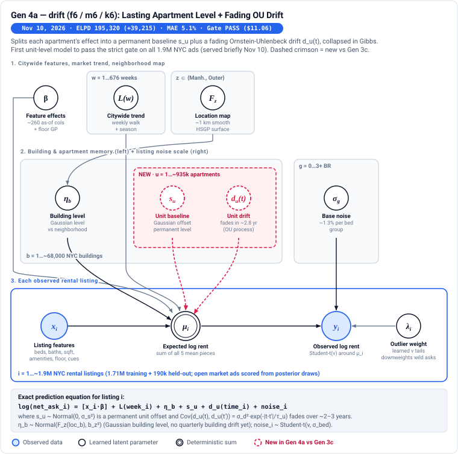

  *What changed & why:* Splits each apartment's memory into a permanent baseline ($s_u$) plus a continuous-time fading Ornstein-Uhlenbeck drift ($d_u(t)$, fading over ~2–3 years so recent listings matter more than 8-year-old ones), with unit latents mathematically integrated out during global updates so all chains converge cleanly.

  - **`drift-building` (normal building levels: `b6`, `b7`, `n7`)** — adds quarterly AR(1) building paths: `elpd 230,885` (+35,565) | `MAE 4.1%` | **MISS** on `bld_sd[outer]` (~10 buildings of 0-bed placeholder ads drove 95–98% of chain spread differences) ([note](../notes/drift-2026-11-10.md)).

    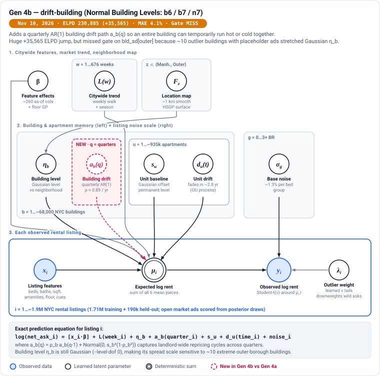

    *What changed & why it missed:* Adding a quarterly AR(1) building drift path ($a_b(q)$, carrying ~89% of its offset year-to-year) captured landlord-wide repricing waves for a massive +35,565 ELPD gain, but Gaussian building levels ($\eta_b$) remained too sensitive to ~10 extreme outer-borough buildings.

    - **`drift-local`** — adds stationary quarterly AR(1) neighborhood drift paths alongside the building paths ([code](../../frontier/src/rentfrontier/drift_local.py)).

      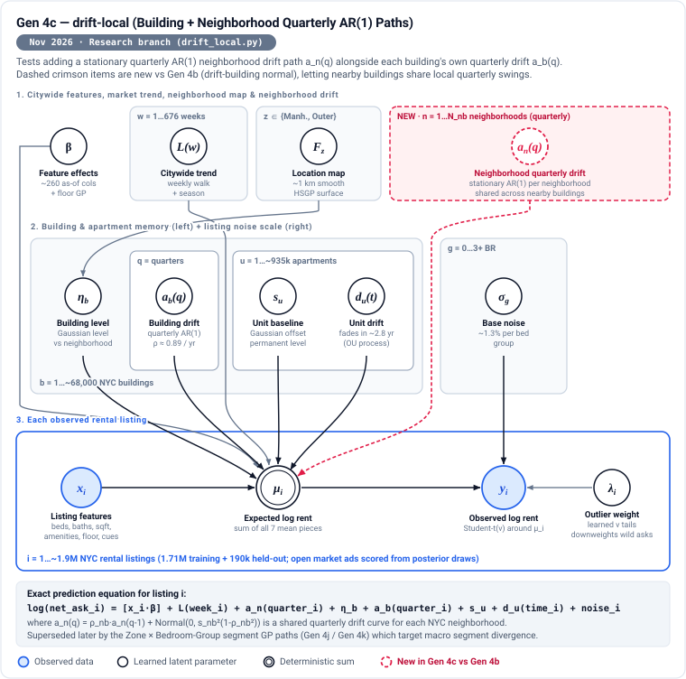

      *What changed & why:* Exploratory branch adding a shared quarterly AR(1) drift curve per neighborhood ($a_n(q)$) so nearby buildings move together between quarters; later superseded by Zone × Bedroom-Group segment GP paths (Gen 4j / Gen 4k).

  - **`drift-building --level-dof 4`** (`b9` / `n9` / `j9`, Nov 10) — Student-t building levels remove leverage: **`elpd 230,989`** | `MAE 4.1%` | `80% cov 80.7%` | **PASS** ($33.02); backtest `j9` elpd `9,979`. **Currently serves `/estimates`, `/price-now`, `/diagnostics`** ([note](../notes/drift-2026-11-10.md), [code](../../frontier/src/rentfrontier/drift_building.py)).

    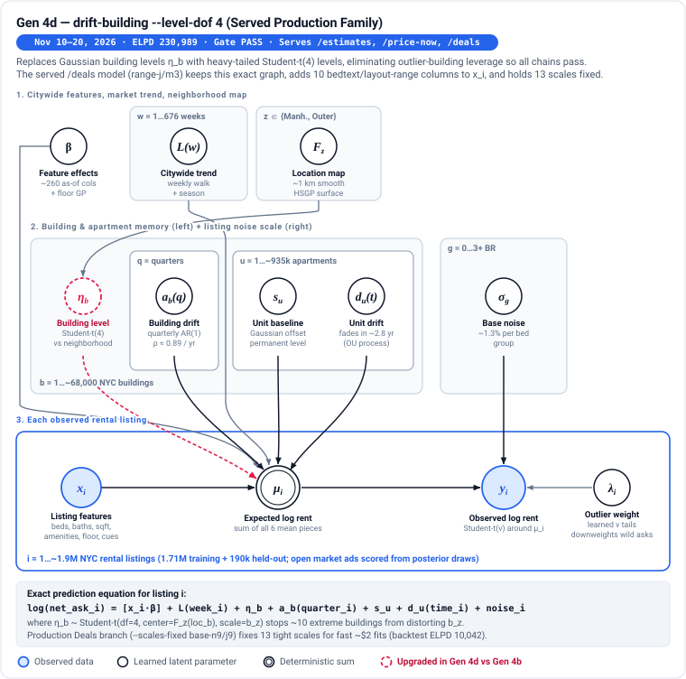

    *What changed & why:* Giving permanent building levels heavy Student-t($\nu_b = 4$) tails neutralized those ~10 outlier buildings so the full model passed the strict gate cleanly and became the production backbone for `/estimates`, `/price-now`, `/diagnostics`, and `/deals`.

    - **Production Held-Scales Branch** (`--scales-fixed base-n9 / base-j9`, ~$2/fit, 1 container; same Gen 4d graphical structure with 13 scale hyperparameters held fixed and added $\mathbf{x}_i$ columns; [note](../notes/scales-fixed-2026-11-17.md)):
      - **`drift-building-bedtext`** (`heldbed-j` / `heldbed-m`, Nov 17) — adds `ad:bed_text_smaller` + unit mean: backtest elpd `9,994` (+21 vs `heldbase-j`) | **PASS**; served `/deals` Nov 17 ([note](../notes/scales-fixed-2026-11-17.md), [code](../../frontier/src/rentfrontier/drift_building_bedtext.py)).
        - `drift-building-bedtext-layout` (`layout-j`, Nov 18) — previous-ad count marks: backtest `+22.8` (SE 13.8), hurt unmarked ads | **PASS / REJECTED** ([note](../notes/low-outliers-2026-11-18.md), [code](../../frontier/src/rentfrontier/drift_building_bedtext_layout.py)).
        - **`drift-building-bedtext-layout-range`** (`range-j` / `range-m` / `range-m2` / `range-m3`) — previous-ad + historical-range count marks: backtest **elpd `10,042`** (+48 vs `heldbed-j`) | **PASS**; **currently serves `/deals`** ([design note](../notes/low-outliers-2026-11-18.md), [Nov 18 refresh](../notes/market-refresh-2026-11-18.md), [Nov 20 refresh](../notes/market-refresh-2026-11-20.md), [Nov 23 plan](../notes/market-refresh-2026-11-23.md), [code](../../frontier/src/rentfrontier/drift_building_bedtext_layout_range.py)).
          - `cr-j` (closing-raise cleaning on `range-j`, Nov 20) — `d_elpd -59.1` (`z = -2.63`) | **PASS / REJECTED** ([note](../notes/deals-closingraise-2026-11-20.md)).
    - **Research Free-Scales Branch** (latest split, 3 containers, ~$11/pool):
      - `c1` (all off-market closing asks rewritten, Nov 11) — +590 on unchanged ads | **MISS** on 4-chain ridge tail ([note](../notes/closing-asks-2026-11-11.md)).
      - **`L1`: `drift-building-phase`** — 6 lease-phase noise scales: `elpd 232,806` | `MAE 4.1%` | `80% cov 79.7%` | **PASS** ([outlier sprint](../notes/outlier-sprint-2026-11-11.md), [code](../../frontier/src/rentfrontier/drift_building_phase.py)).

        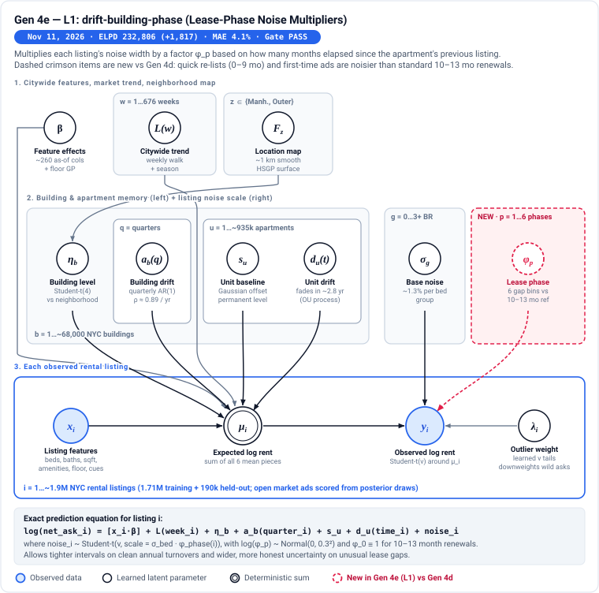

        *What changed & why:* Multiplies each listing's base error bar ($\sigma_g$) by a lease-phase factor ($\phi_p$) based on months since the unit's previous ad (10–13 mo renewals fixed at 1.0×), recognizing that fast re-lists and first-time listings carry noticeably wider price scatter (+1,817 ELPD).

        - `L1T` (+ Student-t unit level, dof=3, free $\nu$) — `elpd 236,901` (+4,095) | **MISS** (`nu` 1.025, `unit_sd` 1.019) ([note](../notes/l1-unit-t-fixed-2026-11-12.md), [code](../../frontier/src/rentfrontier/drift_building_phase_unitt.py)).
        - `L1TK` (+ collapsed unit `kap`) — subsample rehearsal only (~25% gate chance) | **NOT FIT** ([note](../notes/l1-unit-kap-collapsed-2026-11-13.md), [code](../../frontier/src/rentfrontier/drift_building_phase_unitk.py)).
        - **`L1TKN`: `drift-building-phase-unitkn`** (+ Student-t(3) unit level & row `nu` fixed at 2) — **`elpd 236,911`** (+4,106 over L1) | `MAE 4.02%` | `80% cov 80.0%` | **PASS** ($10.82) ([note](../notes/l1-row-dof-fixed-2026-11-13.md), [code](../../frontier/src/rentfrontier/drift_building_phase_unitkn.py)).

          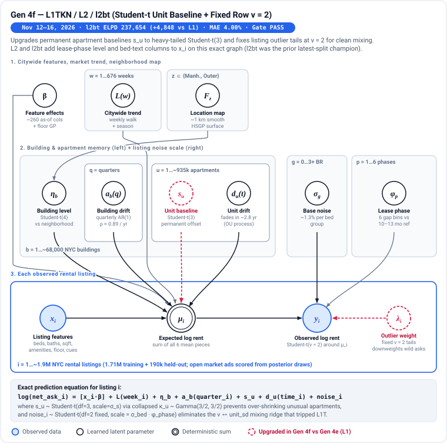

          *What changed & why:* Upgraded permanent apartment baselines ($s_u$) to heavy-tailed Student-t(3) (so genuinely unusual apartments aren't over-shrunk) and fixed listing outlier tails at $\nu = 2$ (breaking the $\nu \leftrightarrow \sigma_s$ ridge that caused `L1T` to miss the gate), jumping +4,106 ELPD cleanly.

          - `drift-building-unitkn` (phase-free ablation, drops $\phi_p$) — short/k50 `-1,241` elpd vs L2 | **NOT SERVED** ([note](../notes/no-phase-2026-11-16.md), [code](../../frontier/src/rentfrontier/drift_building_unitkn.py)).
          - **`L2`: `drift-building-phase-unitkn-level`** (`l2kn`, Nov 14) — + 6 lease-phase level columns in $\mathbf{x}_i$ (same Gen 4f graphical structure): **`elpd 237,431`** (+520) | `MAE 4.01%` | `80% cov 80.1%` | **PASS** ($11.06) ([note](../notes/l2-unitkn-level-2026-11-14.md), [code](../../frontier/src/rentfrontier/drift_building_phase_unitkn_level.py)).
            - Market & backtest test (`l2m` / `l2j`, Nov 15, closing-raise data) — `l2j` **PASS** (elpd `9,981`, bias `+0.015`); `l2m` **MISS** (`phase_scale[1]` R-hat `1.0108`) ([note](../notes/l2-market-2026-11-15.md)).
            - **`l2bt`: `drift-building-phase-unitkn-level-bedtext`** (Nov 16) — + `bedtext` columns in $\mathbf{x}_i$ (same Gen 4f graphical structure): **`elpd 237,654`** (+224) | `MAE 4.00%` | `80% cov 80.1%` | **PASS** ($11.00) — **prior best latest-split model** ([note](../notes/bed-text-2026-11-16.md), [code](../../frontier/src/rentfrontier/drift_building_phase_unitkn_level_bedtext.py)).
              - `bedunit` (ever-flagged unit indicator) — short fit `-122` vs `l2bt` | **DROPPED** standalone, later folded into `unified` ([note](../notes/bed-unit-2026-11-16.md), [code](../../frontier/src/rentfrontier/drift_building_phase_unitkn_level_bedunit.py)).
              - **`Gen 4k`: `drift-building-phase-unitkn-unified` (`u3-mkt`) & `unified-seg` (`u4s-lat`)** (Nov 21–22, PR #1531) — **`u4s-lat` latest ELPD `242,751` (`+5,097.3` vs `l2bt`) | PASS**; **`u3-mkt` market backtest ELPD `10,216` (`+173.8` vs `range-j`) | PASS** — *two distinct models (one passing per split; neither yet paired on both splits)* ([note](../notes/unified-drift-2026-11-21.md), [`unified`](../../frontier/src/rentfrontier/drift_building_phase_unitkn_unified.py), [`unified-seg`](../../frontier/src/rentfrontier/drift_building_phase_unitkn_unified_seg.py)).

                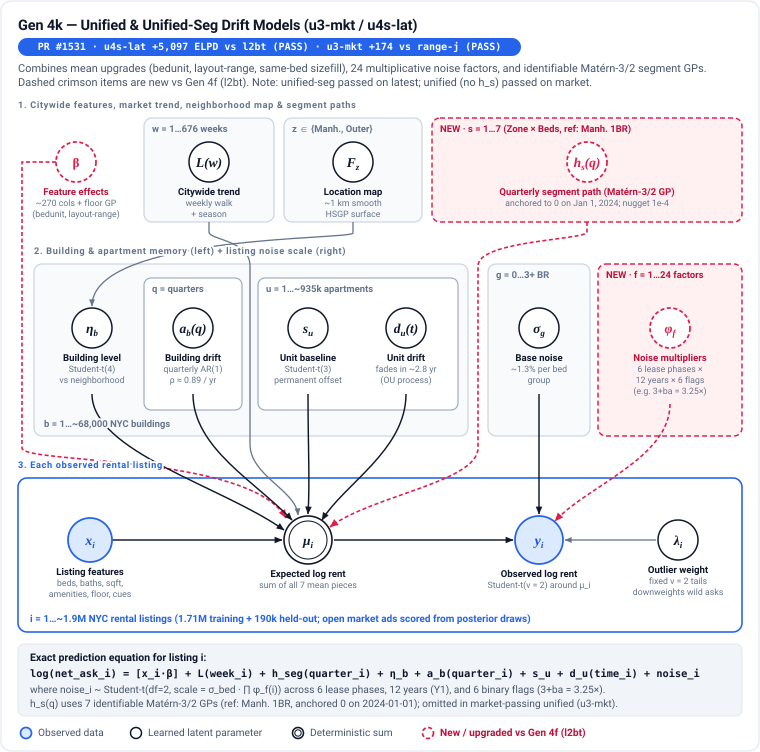

                *What changed & why:* Combines three upgrades on top of `l2bt`: (1) richer listing features in $\boldsymbol{\beta}$ (`bedunit`, `layout-range`, same-bed-first sqft fills, large 0–1BR), (2) 24 multiplicative listing-noise factors $\phi_f$ (6 lease phases × 12 calendar years `Y1` × 6 exogenous flags like 3+ baths = 3.25×), and (3) in `unified-seg`, 7 identifiable Matérn-3/2 quarterly segment GP paths $h_s(q)$ (anchored to 0 on 2024-01-01 relative to Manhattan 1BR) that solved Gen 4j's chain sticking and delivered +5,097 ELPD on `latest`. On the single-date `market` backtest, `unified` (without $h_s$) passed at +173.8 ELPD over `range-j`.
      - **Precursor structural candidates (standalone designs on L1 / L1TKN):**
        - **Y1** calendar-year noise scale (`+1,174` all years / `+329` from 2022; folded into Gen 4k; [Nov 12 note](../notes/year-noise-2026-11-12.md), [Nov 21 sizing](../notes/year-scale-2026-11-21.md), [L1-base code](../../frontier/src/rentfrontier/drift_building_phase_year.py)):

          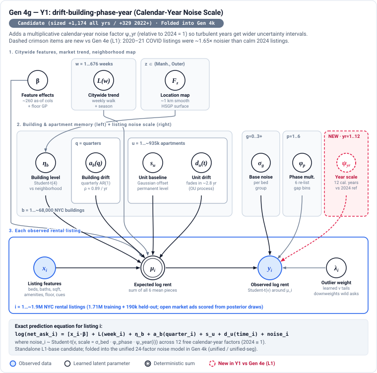

          *What changed & why:* Multiplies every listing's noise scale by a calendar-year factor $\psi_{\text{yr}}$ (2024 fixed at 1.0×), allowing turbulent market regimes like 2020–21 (~1.65× noisier) to carry wider uncertainty intervals without inflating calm years.

        - **D1 / I1** binary-mark noise multipliers — **D1** duplex/penthouse ([note](../notes/duplex-factor-2026-11-13.md), [code](../../frontier/src/rentfrontier/drift_building_phase_duplex.py)) and **I1** `income_restricted_v2` ([note](../notes/income-noise-2026-11-14.md), [code](../../frontier/src/rentfrontier/drift_building_phase_income.py)):

          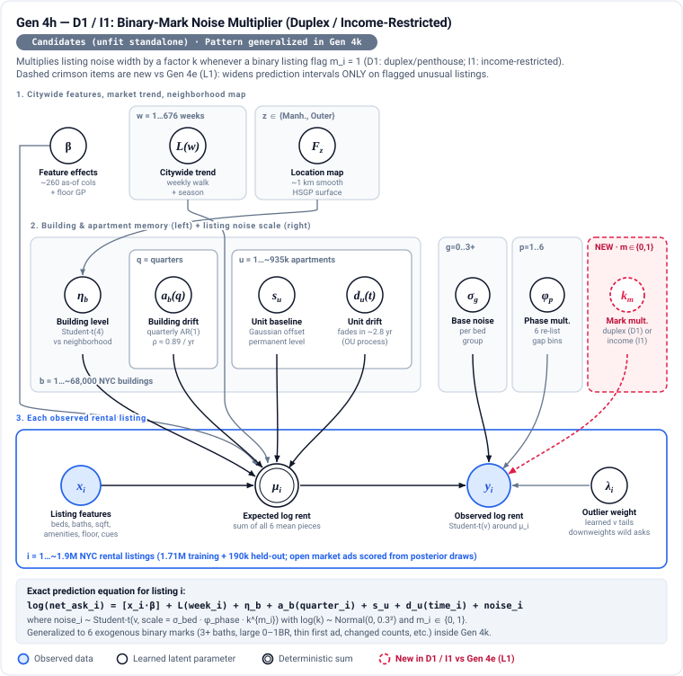

          *What changed & why:* Adds a targeted multiplier $k^{m_i}$ that widens prediction intervals *only* on listings carrying a specific binary mark ($m_i = 1$). This exact pattern was generalized to 6 exogenous flags inside Gen 4k's $\phi_f$.

        - **LN1** building × (bedrooms, full-baths) line level ([design](../notes/line-level-model-2026-11-13.md), [code](../../frontier/src/rentfrontier/drift_building_phase_line.py)):

          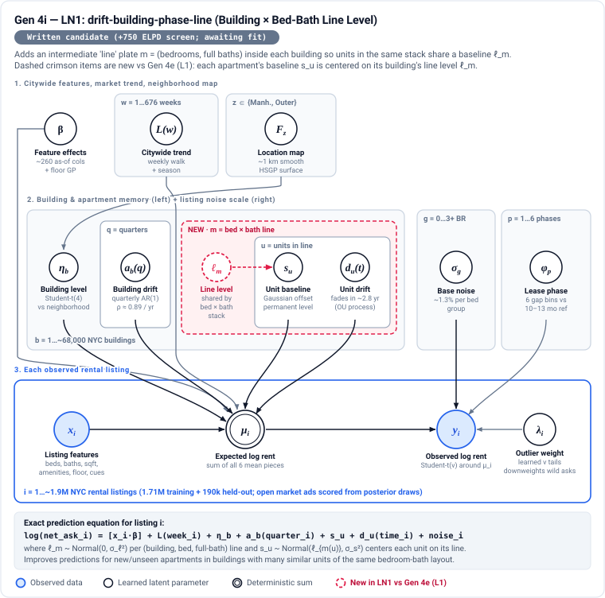

          *What changed & why:* Inserts an intermediate "line" plate ($m = \text{bed} \times \text{full-bath}$) between Building and Apartment so apartments in the same vertical stack/layout share a common baseline $\ell_m$, helping price unseen units in multi-unit buildings.

        - **Segment paths prototype** (`drift-building-phase-unitkn-segment`) — 8 Zone × Bedroom-Group quarterly RBF GP paths ([design](../notes/segment-paths-2026-11-13.md), [k10 rehearsal](../notes/unitkn-segment-k10-2026-11-14.md), [code](../../frontier/src/rentfrontier/drift_building_phase_unitkn_segment.py)):

          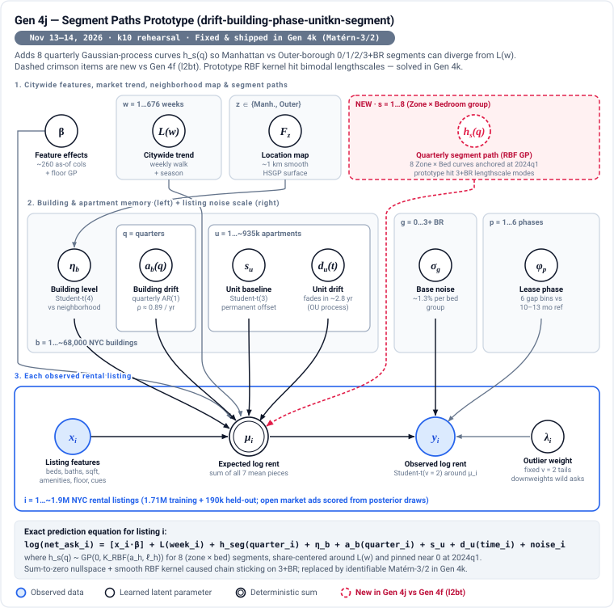

          *What changed & why:* First prototype adding quarterly Zone × Bedroom-Group curves $h_s(q)$ on top of `l2bt`. Its sum-to-zero nullspace and overly smooth RBF kernel caused chain sticking on 3+BR lengthscales — directly fixed by the identifiable Matérn-3/2 parameterization shipped in Gen 4k (`unified-seg`).

        - **Additional sized / non-structural candidates:** **Joint scale/level terms** (`+1,331` from 2022: changed counts, 2/3+ baths, floor 1, top 3%, duplex, 3+BR finish share; [joint sizing](../notes/joint-terms-2026-11-21.md), [flag-change counts & gap bins](../notes/renovation-step-2026-11-21.md), [large 0–1BR](../notes/large-one-beds-asof-2026-11-21.md)), **U4 / U1** unit & size scales ([Nov 21 sizing](../notes/unit-scale-2026-11-21.md)), `--level-dof 8` thin-building shrinkage ([note](../notes/thin-building-shrinkage-2026-11-20.md)), as-of size-fill layer order ([note](../notes/size-fills-read-2026-11-20.md)), and **P1** MapPLUTO as-of columns ([note](../notes/plutoasof-design-2026-11-13.md), [code](../../frontier/src/rentfrontier/drift_building_phase_plutoasof.py)).

---

## 2. Headline Score Comparison (Latest Split & Backtest)

### Latest Split (189,647 held-out ads, same split except closing-raise rows in L1–l2bt)

| Model | Run / Tag | Held-out elpd | Delta vs prev | Median abs err (log) | 80% cov | Gate | Cost | Status |
|---|---|---:|---:|---:|---:|---|---:|---|
| Fit 8 (`asof3_cap64`) | Gen 3 | 148,234 | — | 0.0664 | 79.8% | Pass | — | Historical |
| Kitchen Sink (1 km) | Gen 3 | 156,105 | +7,871 | 0.0636 | 80.1% | Pass | — | Historical |
| Fit 4 (`unitmean`) | Gen 3 | 177,137 | +21,032 | 0.0560 | 78.9% | Miss | — | Historical |
| `drift` | `f6` | 195,320 | +18,183 | 0.0506 | 79.9% | Pass | $3.75 | Served briefly Nov 10 |
| `drift-building` (normal) | `b6` / `b7` | 230,885 | +35,565 | 0.0406 | 80.8% | Miss | ~$11 | Replaced by t-levels |
| `drift-building --level-dof 4` | `b9` | 230,989 | +104 | 0.0406 | 80.7% | Pass | $10.98 | Serves `/estimates` |
| `drift-building-phase` (L1) | `l1` | 232,806 | +1,817 | 0.0407 | 79.7% | Pass | ~$11 | Superseded |
| `drift-building-phase-unitt` (L1T) | `l1t` | 236,901 | +4,095 | 0.0402 | 79.9% | Miss | $10.94 | Sampler fixed in L1TKN |
| `drift-building-phase-unitkn` (L1TKN) | `l1tkn` | 236,911 | +10 | 0.0402 | 80.0% | Pass | $10.82 | Sprint base |
| `drift-building-phase-unitkn-level` (L2) | `l2kn` | 237,431 | +520 | 0.0401 | 80.1% | Pass | $11.06 | Sprint base |
| `drift-building-phase-unitkn-level-bedtext` | `l2bt` | 237,654 | +224 | 0.0400 | 80.1% | Pass | $11.00 | Superseded by `u4s-lat` |
| **`drift-building-phase-unitkn-unified-seg`** | **`u4s-lat`** | **242,751** | **+5,097** | — | **78.2–81.3%** *(by yr)* | **Pass** | **$26.78** | **Best latest-split (no passing market fit yet)** |

### Deals Backtest (9,346 open ads as of 2025-11-10)

| Model | Run / Tag | Final-ask elpd | MAE (log) | 80% cov | Bottom 10% DOM / Cut / Raised | Gate | Status |
|---|---|---:|---:|---:|---|---|---|
| `drift` | `k6` | 8,573 | 0.0557 | 79.5% | 28d / 18% / — | Pass | Historical |
| `drift-building --level-dof 4` | `j9` | 9,979 | 0.0474 | 79.2% | 26d / 18% / 37% | Pass | Base scales (`base-j9`) |
| `drift-building` (held `base-j9`) | `heldbase-j` | 9,973 | 0.0474 | 79.1% | — | Pass | Paired held-scales control |
| `drift-building-bedtext` (held) | `heldbed-j` | 9,994 | — | — | — | Pass | Served Nov 17 |
| `drift-building-bedtext-layout` (held) | `layout-j` | 10,017 | — | — | — | Pass | Rejected (unmarked loss) |
| **`drift-building-bedtext-layout-range` (held)** | **`range-j`** | **10,042** | **0.0469** | **79.2%** | **26d / 17% / 36% (uncautioned: 29d / 19% / 25%)** | **Pass** | **Active `/deals` backtest** |
| `drift-building-bedtext-layout-range` + closing-raise | `cr-j` | -59.1 vs `range-j` | — | 79.0% | — | Pass | Rejected Nov 20 |
| `drift-building-phase-unitkn-level` + closing-raise | `l2j` | 9,981 | 0.0472 | 77.5% | 28d / — / 19% | Pass | Market twin `l2m` missed gate |
| **`drift-building-phase-unitkn-unified`** | **`u3-mkt`** | **10,216** *(+173.8 vs `range-j`)* | — | **76.7%** *(cov drop)* | — | **Pass** | **Best market backtest (no passing latest fit yet)** |

*(Note: `l2j` was fitted on the closing-raise dataset—which `cr-j` later showed costs -59.1 elpd and adds +0.0054 bias on the backtest—partially explaining why `l2j` tied `j9` despite `l2kn` leading `b9` by +6,442 elpd on the latest split. For `u4s-lat` and `u3-mkt`, see the coverage-regression audit and paired-fit requirements in [unified-drift-2026-11-21.md](../notes/unified-drift-2026-11-21.md).)*

---

## 3. Model Structure & Plate Diagram

### Generative Equations

Each observation $i \in \{1, \dots, N\}$ is one rental listing with log final asking rent
$y_i = \log(\text{latest\_ask}_i)$ (net of coded free months), listing date $t_i$ (week $w_i$,
quarter $q_i$), apartment (unit) $u(i)$, building $b(i)$ in zone $z(i) \in \{\text{Manhattan, Outer}\}$,
bedroom noise group $g(i) \in \{0, 1, 2, 3+\}$, and (in `l2bt`) lease phase $p(i) \in \{0,\dots,6\}$:

$$
\begin{aligned}
y_i \mid \mu_i, \lambda_i, \sigma, \phi &\sim \mathcal{N}\!\left(\mu_i,\; \frac{(\sigma_{g(i)}\,\phi_{p(i)})^2}{\lambda_i}\right), \qquad \lambda_i \sim \text{Gamma}\!\left(\frac{\nu}{2},\,\frac{\nu}{2}\right) \\
\mu_i &= \mathbf{x}_i^\top \boldsymbol{\beta} + L(w_i) + \eta_{b(i)} + a_{b(i)}(q_i) + s_{u(i)} + d_{u(i)}(t_i)
\end{aligned}
$$

where:
- **Columns ($\mathbf{x}_i^\top \boldsymbol{\beta}$, ~250–260 coefficients)**: bedroom/bath steps,
  GP floor curves by elevator/walk-up (up to floor 64), log square feet & missingness, unit
  features, building amenities, lot attributes, as-of unit means (`umean:`), plus in the served
  model 10 `bedtext` + `layout-range` columns (and in `l2bt` 6 lease-phase level indicators;
  Gen 4k `unified` adds `bedunit`, `layout-range`, `same_bed_first` size fills, and `large_01br`).
- **Citywide time ($L(w)$)**: weekly Gaussian random walk (step scale $\tau_L$) plus seasonal
  harmonics, ~676 weeks from `2013-12-02` (augmented in `unified-seg` with 7 identifiable
  Matérn-3/2 quarterly segment GP paths $h_s(q)$).
- **Spatial surface ($F_z(s)$)**: 1 km whitened Hilbert-space GP per zone (Manhattan, Outer)
  with learned wave amplitudes $a_z$.
- **Building level ($\eta_b$)**: heavy-tailed around the spatial map,
  $\eta_b \sim \text{StudentT}(\nu_b = 4,\, F_{z(b)}(s_b),\, b_{z(b)})$ (~68,000 buildings).
- **Building quarterly drift ($a_b(q)$)**: stationary quarterly AR(1) per building,
  $a_b(q) = \rho_b\, a_b(q-1) + \mathcal{N}(0,\, s_b^2(1 - \rho_b^2))$, capturing landlord-wide
  repricing cycles.
- **Unit level ($s_u$) & drift ($d_u(t)$)** (~935,000 apartments):
  - Served model (`drift-building-*`): $s_u \sim \mathcal{N}(0, \sigma_s^2)$ (Gaussian).
  - Research frontier (`l1tkn`, `l2kn`, `l2bt`, `unified`, `unified-seg`):
    $s_u \mid \kappa_u \sim \mathcal{N}(0, \sigma_s^2 / \kappa_u)$
    with $\kappa_u \sim \text{Gamma}(3/2, 3/2)$ (Student-t with $\nu_u = 3$), preventing the model
    from over-shrinking genuinely unusual apartments toward their building median.
  - Unit drift $d_u(t)$ is an Ornstein-Uhlenbeck process with stationary variance $\sigma_d^2$ and
    decay timescale $\tau_u$ (years): $\text{Cov}(d_u(t), d_u(t')) = \sigma_d^2 \exp(-|t - t'| / \tau_u)$.
- **Observation noise**:
  - Served model (`--scales-fixed base-n9`): $\phi_p \equiv 1$; 13 tight scales
    $(\nu, \sigma_{0..3}, \sigma_s, \sigma_d, \tau_u, b_{\text{man}}, b_{\text{out}}, s_b, \rho_b, \tau_L)$
    are fixed at `n9` / `j9` posterior means (~$2/fit, 0.35 s/sweep).
  - Research frontier (`l2bt`): $\nu = 2$ fixed (`row_dof_fixed=2`), 6 free lease-phase noise
    multipliers $\phi_p$ relative to the 10–13 month reference phase (expanded in Gen 4k
    `unified` / `unified-seg` to 24 multiplicative factors $\phi_f$: 6 lease phases × 12 calendar
    years × 6 exogenous flags).

### Blocked Partially-Collapsed Gibbs Sweep (`drift.py`)

Sampling convergence on 1.9M rows rests on integrating out latent levels whenever a scale or
fixed effect would otherwise be pinned by them:

1. **Unit precisions**: form padded dense $W_u = (D_u^{-1} + K_u)^{-1}$ per unit (max 22 ads/unit).
2. **Global block ($\theta = (\beta, L, F)$)**: joint Gaussian draw with $\eta_b$ and $u$ integrated out.
3. **Unit + noise scales**: joint slice sample of $(\sigma_s, \sigma_d, \tau_u, \sigma_{0..3}, \nu[, \phi_p])$
   along conditional-curvature directions with $u$, $\eta_b$, $a_b$ integrated out *(skipped under `--scales-fixed`)*.
4. **Slow `bld:` columns**: redrawn with $u$, $\eta_b$, $a_b$ integrated out so quarterly paths do not pin amenities.
5. **Building states ($\eta_b, a_b$) & scales ($b_z, s_b, \rho_b$)**: slice scales collapsed, then joint dense draw (<= 53 dims/building) + Brownian-bridge fill for unobserved quarters.
6. **Unit latents ($u = s + d$)**: exact conditional draw via Matheron's rule *(plus collapsed $\kappa_u$ draw in `unitkn`)*.
7. **Row weights ($\lambda_i$) & GP/walk hyperparameters**: conjugate Gamma draw for $\lambda_i$ + standard slice steps for floor/surface GP scales.

---

## 4. Current Production Stack (as of 2026-11-21)

Today the live site is split across **three different models and four dates**:

| Site section | Live path (`/data1/apartments/site/`) | Model | Run(s) | Data date | Notes / drift |
|---|---|---|---|---|---|
| `/deals` | `deals/` | `drift-building-bedtext-layout-range` | `range-m3` / `range-j` | 2026-11-20 | Published Nov 21 01:20 ET; 6,502 ads, 1,675 cautioned (12 codes); exact quantiles + own `prev_ask` |
| `/diagnostics` | `diagnostics/` | `drift-building` (`--level-dof 4`) | `b9` / `n9` | 2026-11-09 | Republished Nov 20 with fixed `prev_ask`, still on Nov 10 fits |
| `/estimates` | `estimates/` | `drift-building` (`--level-dof 4`) | `b9` / `n9` | 2026-11-09 | Published Nov 10; 195,423 held-out ads |
| `/price-now` | `today/` | `drift-building` (`--level-dof 4`) | `n9` | 2026-11-09 (day Nov 13) | 936,725 units; weekly grid ended 2026-11-16 (now extrapolating); `drift_today` does not yet support Student-t unit levels |
| Legacy pages | `current/site.sqlite` | Gen 2 all-scraped `m7` | Oct 17/19 | 2026-10-17 | Failed convergence gate (max R-hat 1.093) |

**Goal (Ben, 2026-11-21):** converge all active pages onto a **single unified model** built on the
stronger base (`unitkn` + calibrated noise/unit scales + folded data fixes), updating `drift_today`
to support Student-t unit levels and retiring the fragmented `n9` / `range-m3` / `m7` split.

---

## 5. Research Methodology & Strategic Directions (2026-11-21)

The project's modeling discipline aligns with the **Bayesian Workflow** (Gelman et al.) and
**Murphy's Model Discovery Agent** loop:

1. **Pre-registered predictions & leak-free evaluation**: commit predictions before every fit;
   compare on identical held-out sets (latest split + market backtests) with building-clustered SEs
   and zero rent leakage (`docs/leak-free-scoring.md`).
2. **Whole-dataset outlier & error investigation**: interrogate worst misses and systematic
   residuals across the **entire ~1.9M-row dataset** (not only active listings or one backtest year),
   using blind expert reads to distinguish data errors, missing features, and model misspecification.
3. **Fold findings into the model, not post-hoc cautions**: cautions (`cautions.py`) are temporary
   triage for the Deals UI; validated structural findings (ledger fixes, size-fill ordering,
   year/unit/changed-count scales, floor-1/3+bath/finish/large-small-unit terms) belong inside the
   data rules and generative model itself.
4. **Data -> Model -> Sampler gate debugging**: never rerun a failed gate on a new seed; inspect
   bad rows first, model structure second, sampler geometry third.
5. **Smaller, cheaper experiments & faster iteration (information gain per unit time)**:
   optimize **information gain per unit time**—both by designing the smallest model, data
   subset, and experiment that still delivers a noisy-but-directionally-correct, statistically
   trustable Bayesian update (*"information gain per unit time is the name of the game"* —
   Charlie O'Neill `@oneill_c`, quoting Will Brown `@willcb`: *"for whatever amount of compute
   you have, you will get much more research done if you can just make your experiments
   smaller"*) and by investigating sampler speedups (`slow_within=0.001`, double-pass
   unit/scale sweeps, GPU memory/compile optimizations, or faster inference approximations
   validated against Gibbs) so real fits iterate far faster than 1-hour / $11–$33 pools.
6. **Explanatory macro causes (Covid-19)**: test external NYC Covid-19 infection/hospitalization
   series as an explanatory covariate for the 2020–2022 rent dip and volatility regime alongside
   (rather than purely absorbed by) the observational weekly random walk and year noise scale.
