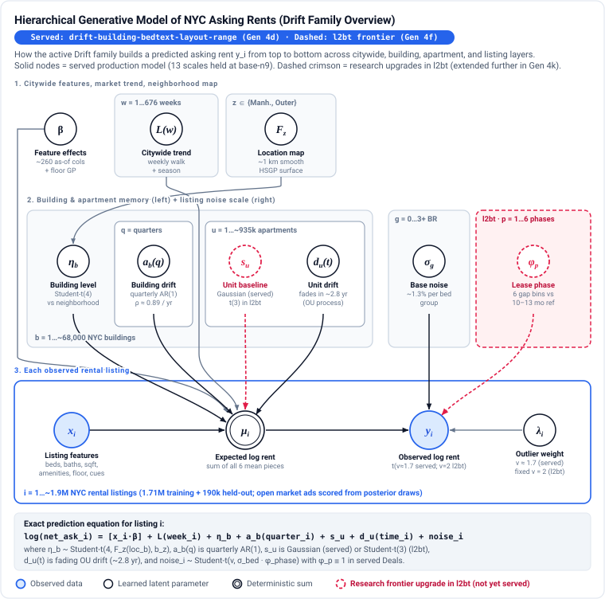

# Model Lineage, Structure & Research Artifact Map

This document is the structural map of the NYC asking-rent modeling project as of **2026-11-21**.
It records how the model evolved across four generations, the tree of branches and outcomes,
the hierarchical graphical structure (plate diagram) of the active Drift model family, what
currently serves each section of the site, and the methodology governing future iterations.

For the full chronological experiment ledger, see [docs/research-record.md](../research-record.md).
For detailed sampler derivations and run commands, see [docs/model/drift.md](drift.md).
For the module-by-module code map, see [frontier/README.md](../../frontier/README.md).

---

## 1. Four-Generation Evolution Tree

Every score on the **latest split** is measured on the same **189,647 held-out ads** (a 10%
unit draw holding out the newest ad of apartments with at least two ads; higher elpd is better,
units are nats). Backtest scores are on the **9,346 open ads as of 2025-11-10** (final asks
for elpd/MAE/coverage; first asks net of coded free months for days-on-market and cut rates).
The convergence gate requires **split R-hat <= 1.01** and **bulk ESS > 400** on every scalar
and coefficient.

Every step below uses plain relative Markdown links to its experiment note and code module
so the tree works natively in any editor, viewer, or git host.

### Generation 1 — Chelsea PyMC / NUTS Line (Aug – Sep 24, 2026)
*52k unit-months, Chelsea only; full narrative in [main-model-evolution.md](main-model-evolution.md).*

- **Sierra monthly & weekly indexes** (Aug 2026) — initial single-building and three-building Bayesian random-walk indexes ([history](main-model-evolution.md)).
  - **All-Chelsea pooled Bayesian** (Sep 8) — 2,386 obs, gate pass, 6.51% holdout MAE vs 11.61% naive ([history](main-model-evolution.md)).
    - **Canonical-unit robust & Bayesian bathrooms** (Sep 17–18) — 52,711 rows, explicit full/half baths, gate pass ([history](main-model-evolution.md)).
      - **Floor natural cubic spline + expanded proxies** (Sep 19) — replaced 51 increments (6.96M -> 1.51M leapfrog transitions), gate pass ([spline](floor-spline-experiment-2026-09-19.md), [expanded](expanded-floor-source-experiment-2026-09-19.md)).
        - **Bedroom-group time curves + building half-year drift walk** (Sep 22–23) — +825.5 row / +379.5 unit elpd, gate pass ([bedroom time](bedroom-time-experiment-2026-09-22.md), [building drift](building-drift-experiment-2026-09-23.md)).
          - **Combined v2 bridge** (Sep 24) — per-building slopes + as-of flags + unit drift; final PyMC/NUTS model ([note](combined-v2-bridge-2026-09-24.md)).

### Generation 2 — Frontier GPU Gibbs Line (Sep 24 – Oct 17, 2026)
*Chelsea -> NB5 -> NB8 -> NB9 -> All-Scraped Manhattan & Brooklyn; see [leaderboard](leaderboard/leaderboard.md) and [feature-tests.md](feature-tests.md).*

- **`m0-base` -> `m1-walk` -> `m5-nocurves`** (Sep 24–29) — custom JAX GPU Gibbs sampler, +9,747 LOO, served Sep 29 ([leaderboard](leaderboard/leaderboard.md)).
  - `m6-slopes` — per-building size/bath slopes; **failed** all-effects gate on bimodal 110 W 26th ([leaderboard](leaderboard/leaderboard.md)).
  - **`m7-tunits`** (Student-t unit levels, +12,891 LOO) -> **`m8-drift`** (per-unit linear drift, +13,230 LOO) ([leaderboard](leaderboard/leaderboard.md)).
  - **Multi-neighborhood Design C** (`bednoise` + `dayfourier` + `bedtime` + `yearnoise` + `sizeunkslope`) — served on NB5 (Oct 8), NB8 (Oct 10), and all-scraped Manhattan+Brooklyn (Oct 17); **gate miss** on all-scraped (`max R-hat 1.093`, `ESS 11.7`), still backs legacy `site/current/site.sqlite` ([mixing review](mixing-review-2026-10-17.md)).
  - *Methodological foundations adopted here:* [leak-free latest split](../leak-free-scoring.md) (Oct 7), clustered SEs and [new-building score](newbuilding-2026-10-13.md) (Oct 13).

### Generation 3 — B0 / Building-Zones Line (Oct 18 – Oct 24, 2026)
*Fresh start on 1.90M NYC-wide ads; none served, but became the exact column, map, and walk backbone of Generation 4.*

- **[`b0` baseline](b0-baseline-2026-10-18.md)** -> normal walk -> two-zone whitened 1 km HSGP -> **[`building_zones_gibbs`](../notes/building-zones-gibbs-2026-10-20.md)** -> **[as-of floor curves](../notes/building-zones-floor-asof-2026-10-23.md)**:
  - **Fit 8 (`asof3_cap64`)** — `elpd 148,234` | `MAE 6.9%` | `80% cov 79.8%` | **PASS** ([note](../notes/building-zones-floor-asof3-cap64-2026-10-23.md), [code](../../frontier/src/rentfrontier/building_zones_floor_asof3_cap64.py)).
  - **Fit 4 (`unitmean`)** — fixed unit effect: `elpd 177,137` (+28,903) | `MAE 5.8%` | `80% cov 78.9%` | **MISS** (68/121 beta pinned by unit effects) ([note](../notes/building-zones-floor-asof3-unitmean-2026-10-23.md), [code](../../frontier/src/rentfrontier/building_zones_floor_asof3_unitmean.py)).
  - **Kitchen Sink (1 km, ~250 as-of cols)** — `elpd 156,105` (+7,871) | `MAE 6.6%` | `80% cov 80.1%` | **PASS** ([note](../notes/kitchen-sink-2026-10-23.md), [code](../../frontier/src/rentfrontier/building_zones_kitchen_sink.py)).
    - Kitchen Sink 150 m — OOM on 39.5 GiB GPU ([code](../../frontier/src/rentfrontier/building_zones_kitchen_sink_150m.py)).

### Generation 4 — Drift Line (Nov 10 – Nov 21, 2026)
*Aim reset on 2026-11-10: descriptive asking-rent pricing with honest uncertainty for finding good deals.*

- **`drift`** (`f6` / `m6` / `k6`, Nov 10) — lasting unit level + OU unit drift: `elpd 195,320` (+39,215) | `MAE 5.1%` | `80% cov 79.9%` | **PASS** ($11.06); first unit-level model to pass on full data, served briefly Nov 10 ([note](../notes/drift-2026-11-10.md), [code](../../frontier/src/rentfrontier/drift.py)).
  - **`drift-building` (normal building levels: `b6`, `b7`, `n7`)** — adds quarterly AR(1) building paths: `elpd 230,885` (+35,565) | `MAE 4.1%` | **MISS** on `bld_sd[outer]` (~10 buildings of 0-bed placeholder ads drove 95–98% of chain spread differences) ([note](../notes/drift-2026-11-10.md)).
  - **`drift-building --level-dof 4`** (`b9` / `n9` / `j9`, Nov 10) — Student-t building levels remove leverage: **`elpd 230,989`** | `MAE 4.1%` | `80% cov 80.7%` | **PASS** ($33.02); backtest `j9` elpd `9,979`. **Currently serves `/estimates`, `/price-now`, `/diagnostics`** ([note](../notes/drift-2026-11-10.md), [code](../../frontier/src/rentfrontier/drift_building.py)).
    - **Production Held-Scales Branch** (`--scales-fixed base-n9 / base-j9`, ~$2/fit, 1 container; [note](../notes/scales-fixed-2026-11-17.md)):
      - **`drift-building-bedtext`** (`heldbed-j` / `heldbed-m`, Nov 17) — adds `ad:bed_text_smaller` + unit mean: backtest elpd `9,994` (+21 vs `heldbase-j`) | **PASS**; served `/deals` Nov 17 ([note](../notes/scales-fixed-2026-11-17.md), [code](../../frontier/src/rentfrontier/drift_building_bedtext.py)).
        - `drift-building-bedtext-layout` (`layout-j`, Nov 18) — previous-ad count marks: backtest `+22.8` (SE 13.8), hurt unmarked ads | **PASS / REJECTED** ([note](../notes/low-outliers-2026-11-18.md), [code](../../frontier/src/rentfrontier/drift_building_bedtext_layout.py)).
        - **`drift-building-bedtext-layout-range`** (`range-j` / `range-m` / `range-m2` / `range-m3`) — previous-ad + historical-range count marks: backtest **elpd `10,042`** (+48 vs `heldbed-j`) | **PASS**; **currently serves `/deals`** ([design note](../notes/low-outliers-2026-11-18.md), [Nov 18 refresh](../notes/market-refresh-2026-11-18.md), [Nov 20 refresh](../notes/market-refresh-2026-11-20.md), [Nov 23 plan](../notes/market-refresh-2026-11-23.md), [code](../../frontier/src/rentfrontier/drift_building_bedtext_layout_range.py)).
          - `cr-j` (closing-raise cleaning on `range-j`, Nov 20) — `d_elpd -59.1` (`z = -2.63`) | **PASS / REJECTED** ([note](../notes/deals-closingraise-2026-11-20.md)).
    - **Research Free-Scales Branch** (latest split, 3 containers, ~$11/pool):
      - `c1` (all off-market closing asks rewritten, Nov 11) — +590 on unchanged ads | **MISS** on 4-chain ridge tail ([note](../notes/closing-asks-2026-11-11.md)).
      - **`L1`: `drift-building-phase`** — 6 lease-phase noise scales: `elpd 232,806` | `MAE 4.1%` | `80% cov 79.7%` | **PASS** ([outlier sprint](../notes/outlier-sprint-2026-11-11.md), [code](../../frontier/src/rentfrontier/drift_building_phase.py)).
        - `L1T` (+ Student-t unit level, dof=3) — `elpd 236,901` (+4,095) | **MISS** (`nu` 1.025, `unit_sd` 1.019) ([note](../notes/l1-unit-t-fixed-2026-11-12.md), [code](../../frontier/src/rentfrontier/drift_building_phase_unitt.py)).
        - `L1TK` (+ collapsed unit `kap`) — subsample rehearsal only (~25% gate chance) | **NOT FIT** ([note](../notes/l1-unit-kap-collapsed-2026-11-13.md), [code](../../frontier/src/rentfrontier/drift_building_phase_unitk.py)).
        - **`L1TKN`: `drift-building-phase-unitkn`** (+ row `nu` fixed at 2) — **`elpd 236,911`** (+4,106 over L1) | `MAE 4.02%` | `80% cov 80.0%` | **PASS** ($10.82) ([note](../notes/l1-row-dof-fixed-2026-11-13.md), [code](../../frontier/src/rentfrontier/drift_building_phase_unitkn.py)).
          - `drift-building-unitkn` (phase-free ablation) — short/k50 `-1,241` elpd vs L2 | **NOT SERVED** ([note](../notes/no-phase-2026-11-16.md), [code](../../frontier/src/rentfrontier/drift_building_unitkn.py)).
          - **`L2`: `drift-building-phase-unitkn-level`** (`l2kn`, Nov 14) — + lease-phase levels: **`elpd 237,431`** (+520) | `MAE 4.01%` | `80% cov 80.1%` | **PASS** ($11.06) ([note](../notes/l2-unitkn-level-2026-11-14.md), [code](../../frontier/src/rentfrontier/drift_building_phase_unitkn_level.py)).
            - Market & backtest test (`l2m` / `l2j`, Nov 15, closing-raise data) — `l2j` **PASS** (elpd `9,981`, bias `+0.015`); `l2m` **MISS** (`phase_scale[1]` R-hat `1.0108`) ([note](../notes/l2-market-2026-11-15.md)).
            - **`l2bt`: `drift-building-phase-unitkn-level-bedtext`** (Nov 16) — + `bedtext`: **`elpd 237,654`** (+224) | `MAE 4.00%` | `80% cov 80.1%` | **PASS** ($11.00) — **best latest-split model, unserved** ([note](../notes/bed-text-2026-11-16.md), [code](../../frontier/src/rentfrontier/drift_building_phase_unitkn_level_bedtext.py)).
              - `bedunit` (ever-flagged unit indicator) — short fit `-122` vs `l2bt` | **DROPPED** ([note](../notes/bed-unit-2026-11-16.md), [code](../../frontier/src/rentfrontier/drift_building_phase_unitkn_level_bedunit.py)).
      - **Written / sized candidates awaiting the unified base refit:**
        - **Y1** calendar-year noise scale (`+1,174` all years / `+329` from 2022; [Nov 12 note](../notes/year-noise-2026-11-12.md), [Nov 21 sizing](../notes/year-scale-2026-11-21.md), [L1-base code](../../frontier/src/rentfrontier/drift_building_phase_year.py))
        - **Joint scale/level terms** (`+1,331` from 2022: changed counts, 2/3+ baths, floor 1, top 3%, duplex, 3+BR finish share; [joint sizing](../notes/joint-terms-2026-11-21.md), [flag-change counts & gap bins](../notes/renovation-step-2026-11-21.md), [large 0–1BR](../notes/large-one-beds-asof-2026-11-21.md))
        - **New-unit uncertainty**: **U4 / U1** unit & size scales ([Nov 21 sizing](../notes/unit-scale-2026-11-21.md)), **LN1** building×bedroom level ([design](../notes/line-level-model-2026-11-13.md), [code](../../frontier/src/rentfrontier/drift_building_phase_line.py))
        - **Data & prior cleanup**: `--level-dof 8` thin-building shrinkage ([note](../notes/thin-building-shrinkage-2026-11-20.md)), as-of size-fill layer order ([note](../notes/size-fills-read-2026-11-20.md)), plus written-unfit **D1** ([note](../notes/duplex-factor-2026-11-13.md), [code](../../frontier/src/rentfrontier/drift_building_phase_duplex.py)), **I1** ([note](../notes/income-noise-2026-11-14.md), [code](../../frontier/src/rentfrontier/drift_building_phase_income.py)), **P1** ([note](../notes/plutoasof-design-2026-11-13.md), [code](../../frontier/src/rentfrontier/drift_building_phase_plutoasof.py)), and **segment paths** ([design](../notes/segment-paths-2026-11-13.md), [k10 rehearsal](../notes/unitkn-segment-k10-2026-11-14.md), [code](../../frontier/src/rentfrontier/drift_building_phase_unitkn_segment.py)).

---

## 2. Headline Score Comparison (Latest Split & Backtest)

### Latest Split (189,647 held-out ads, same split except closing-raise rows in L1–l2bt)

| Model | Run / Tag | Held-out elpd | Delta vs prev | Median abs err (log) | 80% cov | Gate | Cost | Status |
|---|---|---:|---:|---:|---:|---|---:|---|
| Fit 8 (`asof3_cap64`) | Gen 3 | 148,234 | — | 0.0664 | 79.8% | Pass | — | Historical |
| Kitchen Sink (1 km) | Gen 3 | 156,105 | +7,871 | 0.0636 | 80.1% | Pass | — | Historical |
| Fit 4 (`unitmean`) | Gen 3 | 177,137 | +21,032 | 0.0560 | 78.9% | Miss | — | Historical |
| `drift` | `f6` | 195,320 | +18,183 | 0.0506 | 79.9% | Pass | $3.75 | Served briefly Nov 10 |
| `drift-building` (normal) | `b6` / `b7` | 230,885 | +35,565 | 0.0406 | 80.8% | Miss | ~$11 | Replaced by t-levels |
| `drift-building --level-dof 4` | `b9` | 230,989 | +104 | 0.0406 | 80.7% | Pass | $10.98 | Serves `/estimates` |
| `drift-building-phase` (L1) | `l1` | 232,806 | +1,817 | 0.0407 | 79.7% | Pass | ~$11 | Superseded |
| `drift-building-phase-unitt` (L1T) | `l1t` | 236,901 | +4,095 | 0.0402 | 79.9% | Miss | $10.94 | Sampler fixed in L1TKN |
| `drift-building-phase-unitkn` (L1TKN) | `l1tkn` | 236,911 | +10 | 0.0402 | 80.0% | Pass | $10.82 | Sprint base |
| `drift-building-phase-unitkn-level` (L2) | `l2kn` | 237,431 | +520 | 0.0401 | 80.1% | Pass | $11.06 | Sprint base |
| **`drift-building-phase-unitkn-level-bedtext`** | **`l2bt`** | **237,654** | **+224** | **0.0400** | **80.1%** | **Pass** | **$11.00** | **Best latest-split (unserved)** |

### Deals Backtest (9,346 open ads as of 2025-11-10)

| Model | Run / Tag | Final-ask elpd | MAE (log) | 80% cov | Bottom 10% DOM / Cut / Raised | Gate | Status |
|---|---|---:|---:|---:|---|---|---|
| `drift` | `k6` | 8,573 | 0.0557 | 79.5% | 28d / 18% / — | Pass | Historical |
| `drift-building --level-dof 4` | `j9` | 9,979 | 0.0474 | 79.2% | 26d / 18% / 37% | Pass | Base scales (`base-j9`) |
| `drift-building` (held `base-j9`) | `heldbase-j` | 9,973 | 0.0474 | 79.1% | — | Pass | Paired held-scales control |
| `drift-building-bedtext` (held) | `heldbed-j` | 9,994 | — | — | — | Pass | Served Nov 17 |
| `drift-building-bedtext-layout` (held) | `layout-j` | 10,017 | — | — | — | Pass | Rejected (unmarked loss) |
| **`drift-building-bedtext-layout-range` (held)** | **`range-j`** | **10,042** | **0.0469** | **79.2%** | **26d / 17% / 36% (uncautioned: 29d / 19% / 25%)** | **Pass** | **Active `/deals` backtest** |
| `drift-building-bedtext-layout-range` + closing-raise | `cr-j` | -59.1 vs `range-j` | — | 79.0% | — | Pass | Rejected Nov 20 |
| `drift-building-phase-unitkn-level` + closing-raise | `l2j` | 9,981 | 0.0472 | 77.5% | 28d / — / 19% | Pass | Market twin `l2m` missed gate |

*(Note: `l2j` was fitted on the closing-raise dataset—which `cr-j` later showed costs -59.1 elpd and adds +0.0054 bias on the backtest—partially explaining why `l2j` tied `j9` despite `l2kn` leading `b9` by +6,442 elpd on the latest split.)*

---

## 3. Model Structure & Plate Diagram

### Generative Equations

Each observation $i \in \{1, \dots, N\}$ is one rental listing with log final asking rent
$y_i = \log(\text{latest\_ask}_i)$ (net of coded free months), listing date $t_i$ (week $w_i$,
quarter $q_i$), apartment (unit) $u(i)$, building $b(i)$ in zone $z(i) \in \{\text{Manhattan, Outer}\}$,
bedroom noise group $g(i) \in \{0, 1, 2, 3+\}$, and (in `l2bt`) lease phase $p(i) \in \{0,\dots,6\}$:

$$
\begin{aligned}
y_i \mid \mu_i, \lambda_i, \sigma, \phi &\sim \mathcal{N}\!\left(\mu_i,\; \frac{(\sigma_{g(i)}\,\phi_{p(i)})^2}{\lambda_i}\right), \qquad \lambda_i \sim \text{Gamma}\!\left(\frac{\nu}{2},\,\frac{\nu}{2}\right) \\
\mu_i &= \mathbf{x}_i^\top \boldsymbol{\beta} + L(w_i) + \eta_{b(i)} + a_{b(i)}(q_i) + s_{u(i)} + d_{u(i)}(t_i)
\end{aligned}
$$

where:
- **Columns ($\mathbf{x}_i^\top \boldsymbol{\beta}$, ~250–260 coefficients)**: bedroom/bath steps,
  GP floor curves by elevator/walk-up (up to floor 64), log square feet & missingness, unit
  features, building amenities, lot attributes, as-of unit means (`umean:`), plus in the served
  model 10 `bedtext` + `layout-range` columns (and in `l2bt` 6 lease-phase level indicators).
- **Citywide time ($L(w)$)**: weekly Gaussian random walk (step scale $\tau_L$) plus seasonal
  harmonics, ~676 weeks from `2013-12-02`.
- **Spatial surface ($F_z(s)$)**: 1 km whitened Hilbert-space GP per zone (Manhattan, Outer)
  with learned wave amplitudes $a_z$.
- **Building level ($\eta_b$)**: heavy-tailed around the spatial map,
  $\eta_b \sim \text{StudentT}(\nu_b = 4,\, F_{z(b)}(s_b),\, b_{z(b)})$ (~68,000 buildings).
- **Building quarterly drift ($a_b(q)$)**: stationary quarterly AR(1) per building,
  $a_b(q) = \rho_b\, a_b(q-1) + \mathcal{N}(0,\, s_b^2(1 - \rho_b^2))$, capturing landlord-wide
  repricing cycles.
- **Unit level ($s_u$) & drift ($d_u(t)$)** (~935,000 apartments):
  - Served model (`drift-building-*`): $s_u \sim \mathcal{N}(0, \sigma_s^2)$ (Gaussian).
  - Research frontier (`l1tkn`, `l2kn`, `l2bt`): $s_u \mid \kappa_u \sim \mathcal{N}(0, \sigma_s^2 / \kappa_u)$
    with $\kappa_u \sim \text{Gamma}(3/2, 3/2)$ (Student-t with $\nu_u = 3$), preventing the model
    from over-shrinking genuinely unusual apartments toward their building median.
  - Unit drift $d_u(t)$ is an Ornstein-Uhlenbeck process with stationary variance $\sigma_d^2$ and
    decay timescale $\tau_u$ (years): $\text{Cov}(d_u(t), d_u(t')) = \sigma_d^2 \exp(-|t - t'| / \tau_u)$.
- **Observation noise**:
  - Served model (`--scales-fixed base-n9`): $\phi_p \equiv 1$; 13 tight scales
    $(\nu, \sigma_{0..3}, \sigma_s, \sigma_d, \tau_u, b_{\text{man}}, b_{\text{out}}, s_b, \rho_b, \tau_L)$
    are fixed at `n9` / `j9` posterior means (~$2/fit, 0.35 s/sweep).
  - Research frontier (`l2bt`): $\nu = 2$ fixed (`row_dof_fixed=2`), 6 free lease-phase noise
    multipliers $\phi_p$ relative to the 10–13 month reference phase.

### Blocked Partially-Collapsed Gibbs Sweep (`drift.py`)

Sampling convergence on 1.9M rows rests on integrating out latent levels whenever a scale or
fixed effect would otherwise be pinned by them:

1. **Unit precisions**: form padded dense $W_u = (D_u^{-1} + K_u)^{-1}$ per unit (max 22 ads/unit).
2. **Global block ($\theta = (\beta, L, F)$)**: joint Gaussian draw with $\eta_b$ and $u$ integrated out.
3. **Unit + noise scales**: joint slice sample of $(\sigma_s, \sigma_d, \tau_u, \sigma_{0..3}, \nu[, \phi_p])$
   along conditional-curvature directions with $u$, $\eta_b$, $a_b$ integrated out *(skipped under `--scales-fixed`)*.
4. **Slow `bld:` columns**: redrawn with $u$, $\eta_b$, $a_b$ integrated out so quarterly paths do not pin amenities.
5. **Building states ($\eta_b, a_b$) & scales ($b_z, s_b, \rho_b$)**: slice scales collapsed, then joint dense draw (<= 53 dims/building) + Brownian-bridge fill for unobserved quarters.
6. **Unit latents ($u = s + d$)**: exact conditional draw via Matheron's rule *(plus collapsed $\kappa_u$ draw in `unitkn`)*.
7. **Row weights ($\lambda_i$) & GP/walk hyperparameters**: conjugate Gamma draw for $\lambda_i$ + standard slice steps for floor/surface GP scales.

---

## 4. Current Production Stack (as of 2026-11-21)

Today the live site is split across **three different models and four dates**:

| Site section | Live path (`/data1/apartments/site/`) | Model | Run(s) | Data date | Notes / drift |
|---|---|---|---|---|---|
| `/deals` | `deals/` | `drift-building-bedtext-layout-range` | `range-m3` / `range-j` | 2026-11-20 | Published Nov 21 01:20 ET; 6,502 ads, 1,675 cautioned (12 codes); exact quantiles + own `prev_ask` |
| `/diagnostics` | `diagnostics/` | `drift-building` (`--level-dof 4`) | `b9` / `n9` | 2026-11-09 | Republished Nov 20 with fixed `prev_ask`, still on Nov 10 fits |
| `/estimates` | `estimates/` | `drift-building` (`--level-dof 4`) | `b9` / `n9` | 2026-11-09 | Published Nov 10; 195,423 held-out ads |
| `/price-now` | `today/` | `drift-building` (`--level-dof 4`) | `n9` | 2026-11-09 (day Nov 13) | 936,725 units; weekly grid ended 2026-11-16 (now extrapolating); `drift_today` does not yet support Student-t unit levels |
| Legacy pages | `current/site.sqlite` | Gen 2 all-scraped `m7` | Oct 17/19 | 2026-10-17 | Failed convergence gate (max R-hat 1.093) |

**Goal (Ben, 2026-11-21):** converge all active pages onto a **single unified model** built on the
stronger base (`unitkn` + calibrated noise/unit scales + folded data fixes), updating `drift_today`
to support Student-t unit levels and retiring the fragmented `n9` / `range-m3` / `m7` split.

---

## 5. Research Methodology & Strategic Directions (2026-11-21)

The project's modeling discipline aligns with the **Bayesian Workflow** (Gelman et al.) and
**Murphy's Model Discovery Agent** loop:

1. **Pre-registered predictions & leak-free evaluation**: commit predictions before every fit;
   compare on identical held-out sets (latest split + market backtests) with building-clustered SEs
   and zero rent leakage (`docs/leak-free-scoring.md`).
2. **Whole-dataset outlier & error investigation**: interrogate worst misses and systematic
   residuals across the **entire ~1.9M-row dataset** (not only active listings or one backtest year),
   using blind expert reads to distinguish data errors, missing features, and model misspecification.
3. **Fold findings into the model, not post-hoc cautions**: cautions (`cautions.py`) are temporary
   triage for the Deals UI; validated structural findings (ledger fixes, size-fill ordering,
   year/unit/changed-count scales, floor-1/3+bath/finish/large-small-unit terms) belong inside the
   data rules and generative model itself.
4. **Data -> Model -> Sampler gate debugging**: never rerun a failed gate on a new seed; inspect
   bad rows first, model structure second, sampler geometry third.
5. **Faster real fits for higher iteration velocity**: investigate sampler speedups (e.g.,
   `slow_within=0.001`, double-pass unit/scale sweeps, GPU memory/compile optimizations, or
   faster inference approximations validated against Gibbs) so real full-data fits iterate faster
   than 1-hour / $11–$33 pools.
6. **Explanatory macro causes (Covid-19)**: test external NYC Covid-19 infection/hospitalization
   series as an explanatory covariate for the 2020–2022 rent dip and volatility regime alongside
   (rather than purely absorbed by) the observational weekly random walk and year noise scale.
