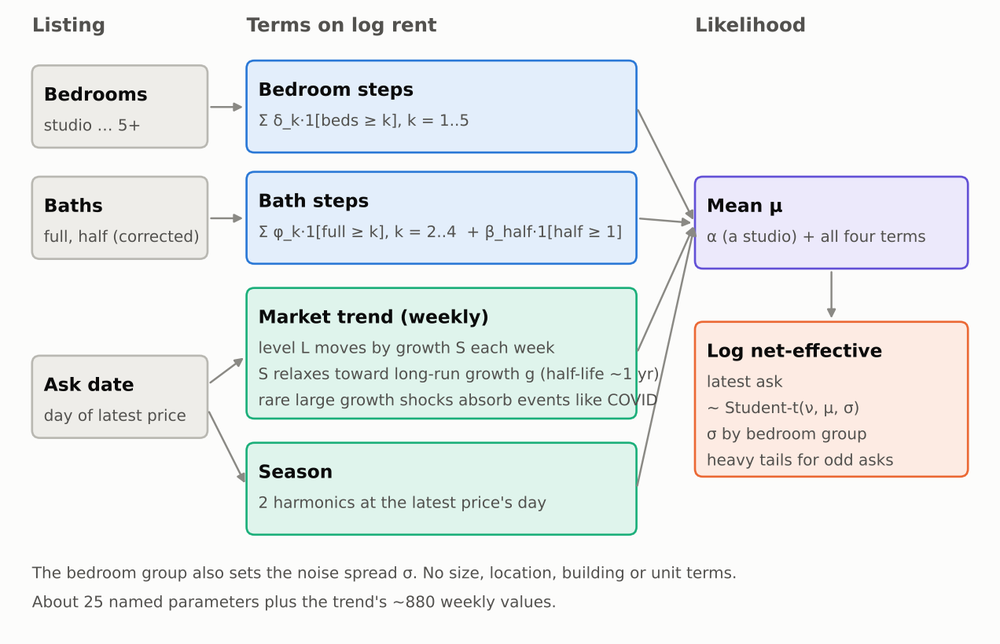
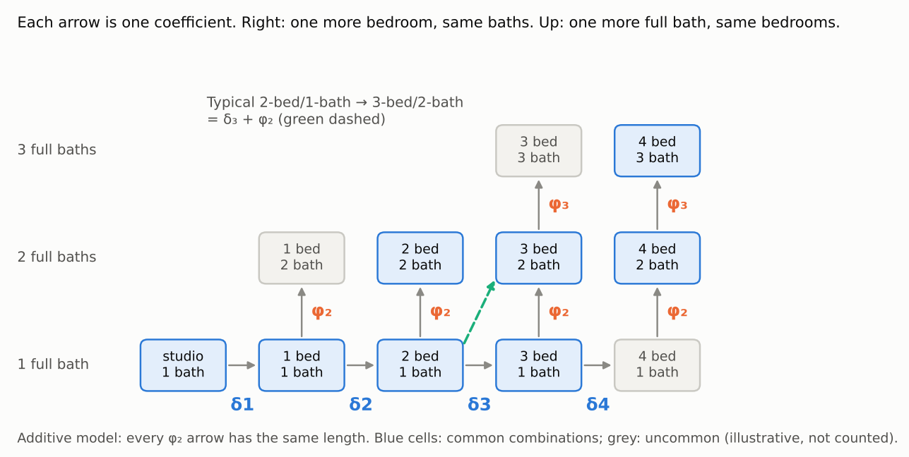
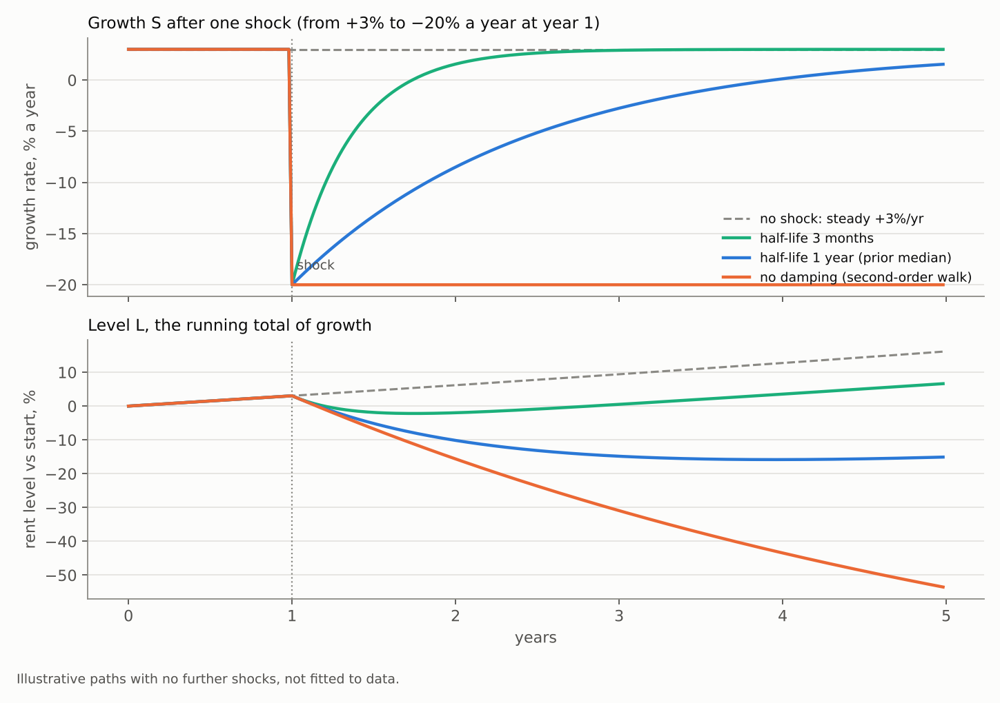
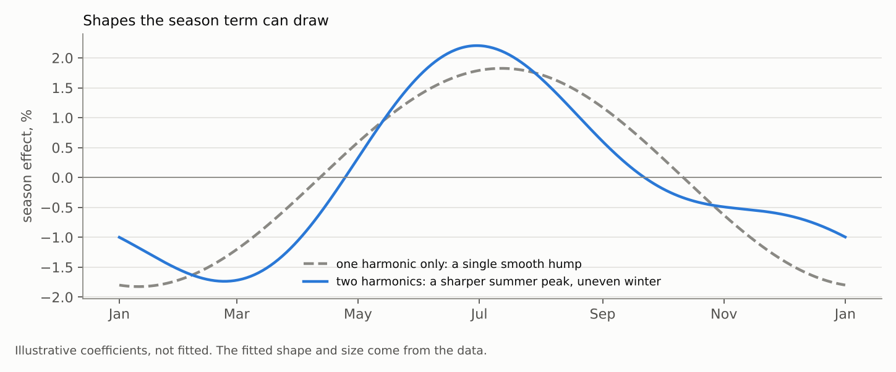

# Baseline model B0: bedrooms, bathrooms, market trend and season

*Written 2026-10-18 for Ben and cleaned up the same day to cover only the chosen model. Everything else from the discussion (other trends, later rungs, interaction tests, checks) is in `modeling/baseline-backlog-2026-10-18.md`. This is a design proposal: no fit was launched and no code changed. Cost figures are scaled from the served fit's stage records, not timed. Literature citations are from memory.*

## 1. What it is

A small Bayesian hedonic model of log asking rent with four parts: bedroom steps, bathroom steps, a citywide weekly market trend and a two-harmonic season. The noise is Student-t with a spread per bedroom group. It has no size, location, building or unit terms. It has about 25 named parameters plus the trend's weekly values, and should cost about $1 to $2 and 25 to 40 minutes on Modal.

For listing row *i* with bedrooms *b*, full baths *f*, half baths *h*, and the date *t* of its latest price:

```
y_i = log(net-effective latest ask_i)

y_i = α + Bed(b_i) + Bath(f_i, h_i) + T(t_i) + S(t_i) + ε_i
ε_i ~ Student-t(ν, 0, σ_g(b_i))
```



*Figure 1. The whole model.*

## 2. Target and timestamp

- **Target.** The latest ask, net of free months, as the pipeline computes it (#1139). "Latest" means the most recent price we've seen, including ads whose later cuts we haven't seen yet (Ben, 2026-10-18).
- **Timestamp.** Trend and season are read at the date of that latest price, not the ad's first day.
- **Reading coefficients.** Each coefficient is a percentage premium, `100·(e^β − 1)`, computed per draw and reported as a median and interval.

## 3. Bedrooms

Levels studio, 1, 2, 3, 4 and 5+. Each row gets one indicator per threshold it clears, so a 3-bed has "more than studio", "more than 1-bed" and "more than 2-bed" (Ben's construction):

```
Bed(b) = Σ_{k=1..5} δ_k · 1[b ≥ k]        studio is the intercept's level
δ_k ~ Normal(0.15, 0.3), independent
```

- Each δ_k is the premium of the k-th bedroom over k − 1 *with the same baths*. The steps are on a common scale and can be combined later; they compound, so four +15% steps make about +75%.
- No pooling across steps: with about 1.7 million rows the data set every step, and the steps have no reason to share a size. Revisit if the 5+ level turns out to have only a few hundred rows (not yet counted).
- Steps are unconstrained in sign.
- B0 leaves size out, so each bedroom step includes the extra floor area that comes with another bedroom. It is the premium of a typical k-bed over a typical (k−1)-bed at equal baths, not the value of a room in fixed space.

## 4. Bathrooms

The corrected full and half counts are read, not the ad's own `bathrooms` figure (1,593 rows corrected). Same step construction as the bedrooms:

```
Bath(f, h) = Σ_{k=2..4} φ_k · 1[f ≥ k] + β_half · 1[h ≥ 1] + β_bath_unknown · 1[baths missing]
φ_k ~ Normal(0.1, 0.2), independent;  full baths capped at 4+
β_half ~ Normal(0.03, 0.05)
```

- Each φ_k is the premium of the k-th full bath *with the same bedrooms*. A typical upgrade combines both: a 2-bed with 1 bath to a 3-bed with 2 baths is δ_3 + φ_2.
- The model is additive: a second bath adds the same percentage at every bedroom count.
- A half bath is its own indicator, off the full-bath ladder, because a powder room is a different good from a fraction of a bathroom. A 2.5-bath unit is "2 full + half". Some ads round a half bath up to a full one, so φ_2 will absorb a little half-bath value.



*Figure 2. How the steps combine. The shading is illustrative; cell counts haven't been checked.*

## 5. Market trend

A damped local linear trend on a weekly grid, with heavy-tailed changes in slope. The city's rent has a level L and a weekly growth rate S. Each week the level moves by the growth rate, and the growth rate relaxes toward a long-run rate g with occasional large shocks.

```
weekly grid w = 1..W (W ≈ 880); each ask is read off by linear interpolation between its two neighbouring weeks
T(t_i) = (1 − u)·L_w + u·L_{w+1},   u = fraction of the way from week w to w + 1

L_0 = 0                                      the intercept carries the level
L_w = L_{w−1} + S_{w−1}                      level: running total of growth, no shock of its own
S_0 ~ Normal(g, τ²/(1 − ρ²))
S_w = g + ρ·(S_{w−1} − g) + η_w              growth: AR(1) around g
η_w | λ_w ~ Normal(0, τ²/λ_w),  λ_w ~ Gamma(ν_T/2, ν_T/2)    so η_w ~ Student-t(ν_T, 0, τ)

g   ~ Normal(0.03/52, 0.03/52)               long-run growth, about +3% a year
ρ   = 0.5^(1/h),  h ~ LogNormal(log 52, 0.5) half-life of a growth deviation, about a year
τ   ~ PC prior, small                        calm weeks barely move the growth rate
ν_T ~ Gamma(2, 1), ν_T > 1                   tail weight of growth shocks
```

In time-series terms the level is an ARIMA(1,1,0) with drift and Student-t shocks.

How it meets the requirements set in the thread:

| Requirement | How it is met |
|---|---|
| One citywide trend, separate from the season | one level and one growth rate for the city; the season is its own term |
| Finer than quarterly and continuous in time | weekly grid with interpolation, so the 31st and the 1st sit side by side |
| One quarter's listings can't bend it | in calm periods the growth rate barely changes, so a shift has to persist across many weeks to move the line |
| COVID-like shocks need no special term | a few weeks take large growth shocks from the heavy tail; 2020–22 becomes a handful of bends and nothing names the event |
| Sensible forecasts | growth relaxes back toward g with a half-life near a year, and forecast intervals include the chance of a new shock |

Its special cases are readable from the posterior without separate fits: τ near 0 is fixed compounding growth, ρ near 1 is an undamped second-order walk, and ρ near 0 is steady growth plus a heavy-tailed first-order walk.



*Figure 3. What damping does after one shock. With a half-life near a year, growth recovers over a few years and the level ends permanently lower but bounded; with no damping, the drop never stops. Illustrative, not fitted.*

**Fit.** Given the λ_w, level and growth are jointly Gaussian with a block-tridiagonal precision, drawn in one banded solve like the served walk. Each λ_w has a conjugate Gamma update, as the served residuals do.

**Risk.** B0 has no location, so a change in scrape coverage or listing mix looks like a market shock. Every week with λ_w well below 1 is checked against the scrape coverage record before it is read as a market event.

## 6. Season

Two harmonics, evaluated at the latest price's own day (Ben, 2026-10-18):

```
S(t) = Σ_{k=1,2} [a_k sin(2πk·t/365.25) + c_k cos(2πk·t/365.25)]
a_k, c_k ~ Normal(0, 0.05)
```

Two harmonics represent a season that is smooth at about a three-month scale. The season's shape and size are the same every year.



*Figure 4. The second harmonic lets the summer peak be sharper than a single sine wave. Illustrative coefficients, not fitted.*

## 7. Noise and rows

- **Noise.** Student-t with ν estimated, σ_g ~ Half-Normal(0.3) for each bedroom group (studio, 1, 2, 3+), ν ~ Gamma(2, 0.1). Heavy tails keep a few mis-coded asks from dragging the steps.
- **Intercept.** α ~ Normal(log 2,800, 0.5), a studio's rent.
- **Rows.** The same rows as the served fit, so paired LOO lines up. Furnished, short-term, room-share and income-restricted lottery rows each get their own offset if they are present, as do ads flagged rent-stabilized.
- **Prior check.** Before fitting, simulate from the priors and confirm they give plausible rents ($1,000 to $30,000).

## 8. How it is scored

Per the project's evaluation framework:

- **Paired PSIS-LOO** against the served fit on shared rows. B0 is expected to lose by a wide margin; the size of the margin is the result.
- **Latest time split**, with coverage against nominal 0.79 and 0.95.
- **Descriptive share** is zero by construction, which makes B0 the anchor of that series.
- **Predictive medians and intervals,** not means, on every reported number.

B0 treats rows as independent although they come from about 870,000 units in 67,000 buildings, so its coefficient intervals are too narrow. Pointwise LOO is still fine for comparing designs; the intervals get a caveat when reported.

## 9. Predictions, written before the fit

My guesses, not checked against the data. A miss is recorded as a miss.

1. B0 loses to the served fit by more than half of the served fit's total gain over an intercept-only model.
2. The 2-bed step δ_2 is +25% to +45%.
3. The 2nd-full-bath step φ_2 is +8% to +20%.
4. The half-bath premium is 0.3 to 0.6 of φ_2.
5. The season peaks between June and August, with a peak-to-trough range of 2% to 6%.
6. The trend's 2020 trough is at least 10% below early 2020.
7. g is between +2% and +4% a year, the growth half-life h is between 6 and 24 months, and ν_T is below 4.
8. At most two of the ten largest growth shocks fall outside March 2020 to December 2022, and any that do coincide with a scrape-coverage change.
9. The residual ν is below 3.

## 10. Cost

About $1 to $2 and 25 to 40 minutes on Modal, inside the 1-hour cap and the $10 daily budget. It waits until fits resume.

## References

- Faulkner and Minin (2018), "Locally adaptive smoothing with Markov random fields and shrinkage priors", *Bayesian Analysis*.
- Gardner and McKenzie (1985), "Forecasting trends in time series", *Management Science*.
- Halvorsen and Palmquist (1980), "The interpretation of dummy variables in semilogarithmic equations", *American Economic Review*.
- Harvey (1989), *Forecasting, Structural Time Series Models and the Kalman Filter*.
- Rosen (1974), "Hedonic prices and implicit markets", *Journal of Political Economy*.
- Simpson, Rue, Riebler, Martins and Sørbye (2017), "Penalising model component complexity", *Statistical Science*.
